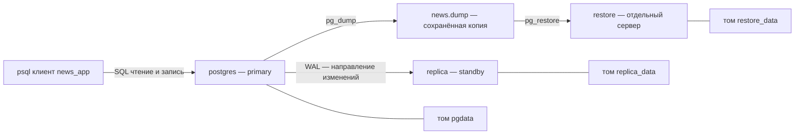
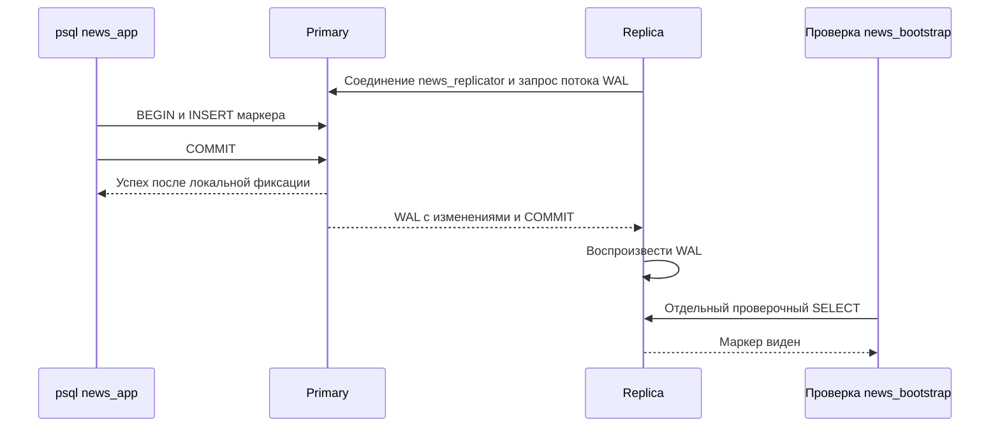

# Лабораторная работа 4 — Безопасность репликация и восстановление PostgreSQL

**Проект:** учебный агрегатор новостей.  
**Среда проверки:** PostgreSQL 18.6, Docker Compose v2, Python 3.10+ и стандартная библиотека.  
**Дата проверки:** 1 ноября 2026 года.

В работе настроены отдельные роли и ограничения доступа, хранение секретов,
резервное копирование и восстановление, физическая потоковая репликация,
эксперименты с остановкой каждого сервера и runbook восстановления.
Все восемь обязательных практических пунктов проверены. Ранее реализованные
RLS и аудит также описаны; новых дополнительных возможностей не добавлялось.

Веб-приложения пока нет. Его доступ к БД демонстрирует настоящий TCP-клиент
`psql` с ролью `news_app`. Это позволяет проверить права, выполнение транзакций
и ошибку соединения, но не поведение HTTP-сервера или пула подключений.
Отдельного шаблона преподаватель не выдавал: стенд построен на имеющемся Compose.

## Содержание

1. [Соответствие требованиям и критериям приёмки](#acceptance)
2. [Устройство стенда и подготовка запуска](#setup)
3. [Отдельные роли администратора приложения и аналитика](#roles)
4. [Запрет административных действий приложения](#privilege-denial)
5. [Разрешённые и запрещённые операции каждой роли](#role-demo)
6. [Секреты вне репозитория](#secrets)
7. [Резервная копия и восстановление в чистый экземпляр](#backup)
8. [Что такое replica и как работает репликация](#replication)
9. [Проверка направления репликации и новой записи](#direction)
10. [Остановки replica и primary](#outages)
11. [Runbook восстановления](#runbook)
12. [Уже реализованные RLS и аудит](#rls-audit)
13. [Последовательность демонстрации на защите](#defense)
14. [Фактические результаты и артефакты](#evidence)
15. [Вопросы для самопроверки](#questions)

<a id="acceptance"></a>
## 1 Соответствие требованиям и критериям приёмки

| Обязательный пункт | Как реализован | Что предъявляется на защите |
| --- | --- | --- |
| Отдельные admin app analyst | Атрибуты ролей, владение БД, GRANT и REVOKE | Три реальных подключения и проверки их прав |
| Приложение без SUPERUSER | NOSUPERUSER, отсутствие членства в сильных ролях, запрет TCP для bootstrap | Отказ `ALTER ROLE news_app SUPERUSER` с SQLSTATE 42501 |
| Разрешённые и запрещённые операции | Три `security/demo_*.sql` | Успешные действия и ожидаемые отказы каждой роли |
| Секреты вне репозитория | Игнорируемый `.env`, случайные пароли, 0600 | Проверка игнорирования и прав файла без печати паролей |
| Backup и restore | Custom dump и транзакционный pg_restore | Пустой новый экземпляр, затем совпадение данных и схемы |
| Primary и replica | pg_basebackup, standby.signal, поток WAL | Роли серверов, streaming, новая запись с primary на replica |
| Остановки узлов | Отдельные stop/start и проба TCP-клиента | Работа без replica, отказ без primary, восстановление |
| Runbook | Признаки, диагностика, действия, проверка целостности | [Рабочий runbook](../recovery/runbook.md) и раздел 11 |

Дополнительный критерий «запуск двух контейнеров сам по себе не считается» выполнен
содержательно: проверяется **направление primary → replica**, новая запись после
запуска репликации и поведение системы при остановке каждого узла.
Проверка не ограничивается статусами `Running` или `Healthy`.

Доказательства уже выполненных запусков:

- [Журнал recovery](../artifacts/recovery/bd-news-recovery-check-af12e211/events.txt): restore, репликация, остановки и восстановление.
- [Журнал обычного запуска](../artifacts/verification/startup.txt): роли, запрещённые действия, существующие RLS и аудит.
- [Подробная запись проверки в OpenSpec](../openspec/changes/archive/2026-11-01-complete-lab4-recovery/verification.md).

`artifacts/` и `openspec/` хранятся локально и не входят в Git. После клонирования
журналы получают повторным запуском команд. Основной код и этот отчёт доступны
из репозитория. Итоговую оценку определяет преподаватель; таблица показывает
проверенные технические результаты, а не обещание количества баллов.

<a id="setup"></a>
## 2 Устройство стенда и подготовка запуска

### 2.1 Три сервера и один клиент



Если просмотрщик не отображает Mermaid: клиент пишет в primary; primary передаёт
изменения replica. Отдельно pg_dump сохраняет файл, из которого pg_restore
восстанавливает третий сервер. Между `restore` и primary нет потока репликации.

| Имя сервиса Compose | Назначение | Особенность |
| --- | --- | --- |
| `postgres` | Primary | В него подключается news_app |
| `replica` | Физический standby | Принимает и воспроизводит WAL |
| `restore` | Цель восстановления | Наполняется только из dump |
| `app` | Одноразовый контейнер с psql | Это SQL-клиент, не веб-приложение |

Основные файлы:

- [compose.yaml](../compose.yaml) — исходный сервер и клиенты с отдельными паролями.
- [recovery/compose.yaml](../recovery/compose.yaml) — настройки primary, replica и restore.
- [scripts/recovery.py](../scripts/recovery.py) — команды `up`, `backup`, `restore`, `outages`, `verify`, `down`, `compose`.
- [start.sh](../start.sh) — подготовка окружения, сервер, роли и миграции.

Фрагмент `Lab.__init__` в `scripts/recovery.py`:

```python
self.env = os.environ | {
    'COMPOSE_PROJECT_NAME': project,
    'COMPOSE_FILE': f'{ROOT / "compose.yaml"}:{ROOT / "recovery/compose.yaml"}',
    'COMPOSE_PROFILES': 'recovery', 'POSTGRES_PORT': '0',
}
```

Имя проекта создаёт отдельное пространство имён Compose. Поэтому его `pgdata`
отличается от `bd-news-labs_pgdata`. Второй файл дополняет первый. Порт `0`
позволяет Docker выбрать свободный порт на loopback. Клиенты внутри сети используют
имя `postgres` и порт `5432`, а не опубликованный порт хоста.

### 2.2 Автоматический прогон

Из корня проекта:

```sh
python3 -m scripts.recovery verify
```

Команда создаёт уникальный проект `bd-news-recovery-check-…`, проходит все проверки
recovery и в `finally` удаляет **только его** контейнеры и тома. Журнал и dump остаются
локально. Основной `bd-news-labs` не требуется запускать.

Для прежних проверок ролей и обычного запуска отдельного основного стенда:

```sh
python3 -m scripts.verify_startup
```

Эта команда также использует временный проект и сохраняет журнал.
`recovery verify` не заменяет проверку всех прав: это два дополняющих друг друга запуска.

### 2.3 Стенд для пошаговой демонстрации

Далее все команды `lab ...` выполняются **в одном терминале из корня проекта**.
Сначала один раз определить сокращение:

```sh
LAB_PROJECT=bd-news-recovery-report
lab() { python3 -m scripts.recovery --project "$LAB_PROJECT" "$@"; }
dc() {
  POSTGRES_PORT=0 docker compose -p "$LAB_PROJECT" \
    -f compose.yaml -f recovery/compose.yaml "$@"
}
lab up
dc ps
```

`lab` вызывает готовые сценарии Python, а `dc` — Docker Compose напрямую.
Обе функции используют одно имя проекта и те же два файла конфигурации.
Прямой вызов `dc` сохраняет stdout, stderr и исходный код возврата psql —
это удобно для демонстрации разрешений. Функции только сокращают команды.
При повторной демонстрации с уже заполненным restore следует выбрать новое имя,
например `bd-news-recovery-report2`.

`up` создаёт `.env`, если нужно, применяет роли и миграции, загружает маленький seed,
создаёт проверочную схему и запускает replica. Существующие данные при повторном
`up` сохраняются. В SQL-примерах ниже используется `news_aggregator`; при изменённом
`POSTGRES_DB` нужно подставить своё имя.

<a id="roles"></a>
## 3 Отдельные роли администратора приложения и аналитика

### 3.1 Два разных значения слова роль

Роль PostgreSQL определяет, кто подключился и какие действия БД ему разрешает.
Предметная таблица `public.role` описывает пользователей новостного портала.
Запись «администратор портала» в таблице не выдаёт `SUPERUSER` PostgreSQL.

Например, будущий сайт обслужит пользователей Ивана и Елену через один технический
логин `news_app`. Их персональный идентификатор передаётся отдельно через
`app.current_user_id`. Пароль БД конечным пользователям не выдаётся.

### 3.2 Роли проекта

| Роль | Для чего нужна | Чего не получает |
| --- | --- | --- |
| `news_admin` | Владелец проектной БД, миграции, схемы, обслуживание данных | SUPERUSER, создание ролей кластера, чтение серверных файлов |
| `news_app` | Предметные операции будущего приложения | DDL, TRUNCATE, повышение прав, доступ к журналу аудита |
| `news_analyst` | Чтение публикаций и неперсональной статистики | Запись, аккаунты, подписки, избранное, аудит |
| `news_bootstrap` | Локальная начальная настройка кластера | TCP-подключение запрещено HBA |
| `news_replicator` | Базовая копия и получение WAL в recovery-стенде | SUPERUSER, создание БД и ролей; обычный TCP-доступ на primary запрещён HBA |

Первые три реализуют требование задания. Последние две — отдельные служебные
идентичности. Администратор проекта намеренно отличается от суперпользователя
кластера: владение одной БД не должно давать управление всем сервером.

В [security/roles.sql](../security/roles.sql) роли сначала создаются при отсутствии,
затем им повторно задаются ограничения. Фрагмент:

```sql
ALTER ROLE news_app LOGIN NOSUPERUSER NOCREATEDB NOCREATEROLE
  NOREPLICATION NOBYPASSRLS NOINHERIT;
```

| Атрибут | Смысл в нашей конфигурации |
| --- | --- |
| `LOGIN` | Роль может быть начальным логином соединения |
| `NOSUPERUSER` | Обычные проверки прав не обходятся |
| `NOCREATEDB` | Нельзя создавать базы |
| `NOCREATEROLE` | Нельзя администрировать роли кластера |
| `NOREPLICATION` | Нельзя запрашивать физическую репликацию |
| `NOBYPASSRLS` | Нет специального права обхода всех политик RLS |
| `NOINHERIT` | Не используется автоматическое наследование прав через членство |

Семантика атрибутов описана в [документации PostgreSQL 18](https://www.postgresql.org/docs/18/role-attributes.html).
Самого `NOINHERIT` недостаточно против `SET ROLE`: поэтому `roles.sql`
дополнительно удаляет существующее членство трёх пользовательских ролей в других ролях.

### 3.3 Права на конкретные объекты

Атрибуты определяют возможности роли на уровне кластера. Доступ к таблицам задаётся
отдельно в [security/grants.sql](../security/grants.sql).

Например, приложение может добавлять новости, но не переписывать сохранённые:

```sql
-- Этот набор прав формируется циклом GRANT в security/grants.sql.
GRANT SELECT, INSERT ON public.news TO news_app;
```

В коде список таблиц и привилегий хранится в `VALUES`, а затем выполняется
`GRANT` через `format('%I', ...)`, который корректно оформляет SQL-идентификаторы.
Отдельный `USAGE` выдаётся identity-последовательностям: разрешения на таблицу
и на получение её следующего идентификатора учитываются раздельно.

Права приложения по группам:

| Таблицы | Разрешённые действия |
| --- | --- |
| `role` | SELECT |
| `app_user`, `category`, `news_source`, `scrape_run` | SELECT, INSERT, UPDATE |
| `news`, `import_result`, `scrape_error_log` | SELECT, INSERT |
| `news_category`, `favorite`, обе подписки | SELECT, INSERT, DELETE |

Аналитик читает восемь неперсональных таблиц: `role`, `category`, `news_source`,
`news`, `news_category`, `scrape_run`, `import_result`, `scrape_error_log`.
Поэтому «только чтение» не означает «можно читать абсолютно всё».

<a id="privilege-denial"></a>
## 4 Запрет административных действий приложения

### 4.1 Ограничение действует на нескольких уровнях

1. Контейнер `app` получает `PGUSER=news_app` и только свой `APP_PASSWORD`.
2. Роль не является суперпользователем и не состоит в административных ролях.
3. На таблицы и схемы выдаются только необходимые права.
4. Даже отдельный служебный суперпользователь `news_bootstrap` закрыт для TCP.

Фрагмент [security/pg_hba.conf](../security/pg_hba.conf):

```text
local all all peer map=container_admin
host all news_bootstrap 0.0.0.0/0 reject
host all news_bootstrap ::/0 reject
host all all 0.0.0.0/0 scram-sha-256
host all all ::/0 scram-sha-256
```

`local` относится к Unix-сокету внутри контейнера. `peer` проверяет пользователя ОС;
[pg_ident.conf](../security/pg_ident.conf) сопоставляет root/postgres с bootstrap.
`host` относится к сетевому подключению. Первое подходящее правило HBA определяет
проверку: строки `reject` должны находиться выше общего разрешения SCRAM.
[Документация HBA](https://www.postgresql.org/docs/18/auth-pg-hba-conf.html).

### 4.2 Минимальная демонстрация для преподавателя

Сначала показать, кто подключился:

```sh
dc run --rm -T --no-deps app \
  -c 'SELECT current_user, session_user;'
```

Оба значения должны быть `news_app`. Затем отдельно выполнить:

```sh
dc run --rm -T --no-deps app -v VERBOSITY=verbose \
  -c 'ALTER ROLE news_app SUPERUSER;'
```

**Ожидается ошибка с SQLSTATE `42501` и ненулевой код команды.** Это успешная
демонстрация запрета, а не поломка стенда. Не помещайте её между обязательными
шагами в цепочку `&&`: ожидаемая ошибка остановит такую цепочку.
`VERBOSITY=verbose` нужен, чтобы psql показал SQLSTATE.

Также запрещена попытка принять административную роль:

```sh
dc run --rm -T --no-deps app -v VERBOSITY=verbose \
  -c 'SET ROLE news_admin;'
```

Здесь ожидается тот же код `42501`. В существующем журнале startup есть строки
`PASS app: denied become superuser (42501)` и
`PASS app: denied assume administrator identity (42501)`.

<a id="role-demo"></a>
## 5 Разрешённые и запрещённые операции каждой роли

### 5.1 Команды для всех трёх подключений

```sh
dc run --rm -T --no-deps admin \
  -f /workspace/security/demo_admin.sql
dc run --rm -T --no-deps app \
  -f /workspace/security/demo_app.sql
dc run --rm -T --no-deps analyst \
  -f /workspace/security/demo_analyst.sql
```

| Кто | Положительная проверка | Примеры запрещённых действий |
| --- | --- | --- |
| admin | Создаёт, изменяет и удаляет тестовую таблицу | CREATE ROLE, SUPERUSER, чтение pg_authid и серверных файлов |
| app | Создаёт источник/новость/связь, читает, меняет источник и связь | ALTER TABLE, TRUNCATE, UPDATE news, SET ROLE admin |
| analyst | Читает публикации и агрегирует результаты импорта | INSERT/UPDATE/DELETE, аккаунты, избранное, DDL |

Файлы [demo_admin.sql](../security/demo_admin.sql), [demo_app.sql](../security/demo_app.sql)
и [demo_analyst.sql](../security/demo_analyst.sql) начинаются с проверки настоящего
`current_user`. Они выполняются внутри `BEGIN`/`ROLLBACK`: предметные фикстуры
не остаются в БД. Значения identity аудита при этом могут увеличиться —
последовательности не обещают отсутствие пропусков после отката.

### 5.2 Почему отрицательный тест действительно что-то проверяет

Фрагмент цикла из `demo_app.sql`:

```sql
BEGIN
  EXECUTE operation.statement;
  RAISE EXCEPTION 'FAIL app: unexpectedly allowed %', operation.label;
EXCEPTION WHEN insufficient_privilege THEN
  RAISE NOTICE 'PASS app: denied % (42501)', operation.label;
END;
```

Успех запрещённой команды приводит к собственной ошибке `FAIL`.
Обработчик принимает только `insufficient_privilege`, то есть `42501`.
Синтаксическая ошибка или отсутствие таблицы не будут ошибочно засчитаны
как корректное ограничение доступа. Это принципиальнее, чем просто увидеть
слово `ERROR` на экране.

SQLSTATE и exit code — разные вещи. `42501` описывает ошибку PostgreSQL,
а ненулевой код процесса сообщает оболочке, что команда не выполнилась.
Для SQL-отказа проверяется конкретный SQLSTATE; число кода процесса не заменяет
проверку причины. Сетевой случай из раздела 10 отдельно проверяет psql exit=2.

Для основного проекта после `sh start.sh` те же проверки и запрет сетевого
bootstrap запускаются одной командой `sh security/demo.sh`. В приведённом выше
пошаговом сценарии используется изолированный проект через функцию `lab`.

<a id="secrets"></a>
## 6 Секреты вне репозитория

### 6.1 Где находятся пароли

В Git есть только [.env.example](../.env.example) с пустыми полями. Скрипт
[security/init_env.py](../security/init_env.py) генерирует отсутствующие значения:

```python
if not values.get(key):
    values[key] = secrets.token_urlsafe(32)
```

Заполненный `.env` игнорируется [.gitignore](../.gitignore) и получает `0600`:
чтение и запись разрешены только владельцу. Существующие пароли сохраняются.
Это позволяет повторять `start.sh`, не меняя учётные данные при каждом запуске.

| Переменная | Использование |
| --- | --- |
| `POSTGRES_PASSWORD` | Служебный bootstrap |
| `ADMIN_PASSWORD` | Подключение администратора проекта |
| `APP_PASSWORD` | Подключение приложения |
| `ANALYST_PASSWORD` | Подключение аналитика |
| `REPLICATION_PASSWORD` | Репликация только в recovery-стенде |

Клиентские контейнеры монтируют выбранные каталоги SQL, а не весь репозиторий
с `.env`. Серверы и владелец Docker считаются доверенными: доступ к Docker
не является границей защиты от администратора машины.

Проверка без раскрытия значений:

```sh
git check-ignore .env .secrets/recovery
stat -c '%a %n' .env
```

Ожидаются игнорируемые пути и `600 .env`. Вывод `cat .env`, `docker compose config`
или `inspect` с environment к отчёту не прикладывается.

### 6.2 Как секрет используется без вставки в исходный код

В `roles.sql` пароль берётся из окружения процесса psql:

```sql
\getenv app_password APP_PASSWORD
ALTER ROLE news_app PASSWORD :'app_password';
```

`:'app_password'` — безопасное оформление значения psql как SQL-строки, а не пароль
в репозитории. Настройка отключает запись этих utility-команд в pg_stat_statements
и избыточный SQL-лог. Для аутентификации используется SCRAM-SHA-256.
Это не означает, что настроен SSL: шифрование канала — отдельный пункт, здесь он не выполнялся.

Replica хранит пароль в `/var/lib/postgresql/replication.pgpass` с 0600.
Настройка `primary_conninfo` содержит **путь** к passfile. Логический dump
располагается в `.secrets/recovery/<project>/news.dump`, тоже с 0600.
В нём есть учебные данные, поэтому даже такой dump не является публичным приложением
к отчёту. Снимки проверки содержат числа строк и отпечатки, а не строки аккаунтов.

<a id="backup"></a>
## 7 Резервная копия и восстановление в чистый экземпляр

### 7.1 Что именно копируется

Backup — сохранённое состояние, которое можно использовать позднее независимо
от текущего сервера. В проекте логический backup создаёт `pg_dump --format=custom`.
Он сохраняет объекты одной БД: таблицы и строки, последовательности, ограничения,
индексы, функции, триггеры, политики и права на объекты. Это не копирование файлов
работающего каталога данных обычной командой `cp`.

Роли кластера и настройки HBA в этот dump не входят. Их создаёт код проекта
и локальное окружение. Таким образом, для восстановления нужны и проверенный
dump, и Compose/security-файлы, и доступ к локальным секретам.
[Документация pg_dump](https://www.postgresql.org/docs/18/app-pgdump.html).

### 7.2 Создание backup

На запущенном стенде, без параллельных записей:

```sh
lab backup
```

Внутри primary выполняется следующая команда — это фрагмент реализации,
её не требуется отдельно запускать на хосте:

```sh
pg_dump -U news_bootstrap -d "$POSTGRES_DB" --format=custom
```

`-U` выбирает роль, `-d` — БД, custom-формат предназначен для чтения `pg_restore`.
Локальный bootstrap проходит peer-аутентификацию; пароль не передаётся аргументом.

Метод `Lab.backup()` в [scripts/recovery.py](../scripts/recovery.py):

1. Снимает контрольный снимок таблиц, sequences и схемы.
2. Создаёт временный файл с `os.open(..., 0o600)`.
3. Направляет бинарный stdout pg_dump в этот файл.
4. Проверяет код возврата и отсутствие изменения контрольного снимка за время backup.
5. Только после успеха переименовывает временный файл в `news.dump`.
6. Записывает размер и SHA-256 дампа в `backup.json`.

Проверка до/после нужна именно для нашего учебного сравнения. Сам pg_dump умеет
получать согласованный снимок при конкурентной работе; данный стенд намеренно
требует отсутствие посторонних записей для сопоставления внешних отпечатков.

### 7.3 Показать чистоту цели до восстановления

```sh
dc up -d --wait restore
dc exec -T restore psql -X -w -U news_bootstrap -d news_aggregator \
  -c "SELECT count(*) AS public_tables FROM pg_tables WHERE schemaname = 'public';"
```

На новом стенде ожидается `0`. Это отдельный экземпляр и отдельный том, а не
схема внутри primary. Служебные роли и расширение pg_stat_statements уже подготовлены
инициализацией контейнера, но предметных таблиц нет. Миграции для наполнения
restore не запускаются.

Затем:

```sh
lab restore
```

Внутри `restore` выполняется команда такого вида:

```sh
pg_restore -U news_bootstrap -d "$POSTGRES_DB" \
  --single-transaction --exit-on-error \
  /workspace/.secrets/recovery/bd-news-recovery-report/news.dump
```

`--single-transaction` объединяет восстановление в одну транзакцию. При SQL-ошибке
изменения откатываются. `--exit-on-error` останавливает работу на ошибке.
Обёртка заранее проверяет SHA-256 файла и отсутствие пользовательских таблиц,
чтобы не восстанавливать поверх уже заполненной цели.
[Документация pg_restore](https://www.postgresql.org/docs/18/app-pgrestore.html).

Повторный `lab restore` в тот же заполненный экземпляр должен завершиться отказом.
Это защита от случайного смешивания двух состояний данных.

### 7.4 Как доказана корректность

| Что сравнивается | Где реализовано | Какой дефект обнаруживает |
| --- | --- | --- |
| Число строк и отпечаток полного содержимого каждой таблицы | [fingerprint.sql](../recovery/fingerprint.sql) | Потерянная или изменённая строка при совпадающем общем count |
| `last_value` и `is_called` sequences | Тот же SQL | Неправильное состояние выдачи следующих ID |
| Схема pg_dump --schema-only | `Lab.snapshot()` | Изменения определений, прав, владельцев и политик |
| Реальные связи FK | [integrity.sql](../recovery/integrity.sql) | Дочерняя строка с отсутствующим родителем |
| Валидность ограничений и индексов | Тот же SQL | Невалидированные ограничения или неготовые индексы |
| Журнал миграций | Отпечаток schema_migration и integrity.sql | Потерянная версия или изменённые метаданные |

Для отпечатка строки приводятся к JSON, сортируются, объединяются и хешируются.
Один `count(*)` был бы слабой проверкой: пять неправильных строк тоже дадут число пять.
MD5 здесь служит контрольным отпечатком маленького учебного набора, не цифровой
подписью против злоумышленника. Целый dump дополнительно проверяется SHA-256.

После restore PostgreSQL 18 иначе печатает некоторые эквивалентные CHECK:
приведение массива `varchar[]` к `text[]` превращается в приведение каждого
литерала. `normalized_schema()` учитывает только такую узкую эквивалентность
и случайный защитный токен pg_dump. Сами значения CHECK не удаляются из сравнения.

В проверенном запуске совпали **15 таблиц и 9 последовательностей**: 12 предметных
таблиц, `audit_log`, `schema_migration` и `recovery_lab.probe`. В частности,
восстановлены 5 новостей, 6 результатов импорта, 27 записей аудита и 7 миграций.
Размер dump составил **50 295 байт**; в другом запуске размер и отпечаток могут
отличаться из-за времён в seed и служебных метаданных.

### 7.5 Проверка ошибки восстановления

`verify()` проверяет три разных случая:

- Некорректный архив отвергается pg_restore, цель остаётся пустой.
- Из списка объектов намеренно исключается обязательная таблица `role`.
  Восстановление начинает DDL, затем получает `42P01` — отсутствующее отношение.
  Проверяется, что все уже созданные объекты откатились.
- Повторный restore в непустой экземпляр запрещён самой обёрткой.

pg_restore не показывает SQLSTATE в своём обычном stderr. Для второго случая
только тестовая сессия получает `log_error_verbosity=verbose`, а проверка ищет
`42P01` в серверном журнале. Произвольная ошибка не засчитывается вместо ожидаемой.

Backup не становится актуальнее сам по себе: запись, сделанная после `lab backup`,
не появится в уже созданном dump. Для неё нужен новый backup или другой механизм
восстановления. PITR в этой работе не реализуется.

<a id="replication"></a>
## 8 Что такое replica и как работает репликация

### 8.1 Идея на примере новостного портала

Пусть primary уже хранит пять новостей. Импортёр добавляет шестую. Если второй
сервер просто запущен рядом, он ничего не узнает об этой записи. У него своя БД,
свой каталог данных и собственное состояние.

Чтобы второй сервер следовал за первым, ему нужны **исходное состояние** и
**последующие изменения**. В нашем стенде исходное состояние даёт
`pg_basebackup`, а изменения передаются потоком WAL. Такой второй сервер
называется физической replica, или standby.

В учебном эксперименте вместо новой предметной новости вставляется уникальный
маркер в `recovery_lab.probe`. Он проходит тот же механизм физической репликации,
но не меняет содержимое основной предметной модели. Клиент при этом также читает
`public.news`, то есть проверка затрагивает настоящий доступ приложения к данным.

### 8.2 WAL простыми словами

WAL — журнал предварительной записи, Write-Ahead Log. PostgreSQL сохраняет
необходимые записи WAL на диск до записи соответствующих изменённых страниц
данных. После сбоя нужные действия можно воспроизвести по журналу.
Это журнал внутренних изменений, а не текстовый список исходных SQL-запросов.
[Введение в WAL](https://www.postgresql.org/docs/18/wal-intro.html).

Аналогия: основная тетрадь с данными и пронумерованные указания, как её изменять.
Если второму человеку дать копию тетради и все дальнейшие указания по порядку,
он сможет поддерживать такое же содержимое. В PostgreSQL вместо человека работает
процесс воспроизведения WAL, а журнал содержит значительно более низкоуровневые
записи, чем фраза «добавь новость».

Условный пример для понимания, **не фактический формат WAL**:

```text
Исходное состояние: в probe нет метки demo_1

Клиент -> primary: BEGIN; INSERT demo_1; COMMIT;
Primary: сформировать WAL об изменениях и завершении транзакции
Replica: получить WAL и воспроизвести изменения
Новый SELECT на replica: строка demo_1 видна
```

WAL может передаваться ещё до завершения транзакции. Видимость строки для SQL-чтения
на replica определяется воспроизведённым COMMIT и снимком читающей транзакции,
а не просто фактом получения части байтов.

### 8.3 Кто кому передаёт данные



Схема показывает один допустимый порядок при асинхронной репликации: часть WAL
может уйти раньше ответа клиенту. Проверочный SELECT на replica выполняется
служебным подключением теста, а не маршрутизацией запросов приложения на чтение.

**Replica сама устанавливает соединение с primary**, а поток изменений идёт
**от primary к replica**. Это два разных направления: кто инициирует TCP-сеанс
и кто является источником данных. В `primary_conninfo` указан адрес primary,
потому что replica должна знать, куда подключаться.

На primary процесс `walsender` передаёт журнал. На replica `walreceiver`
получает его; процесс startup/recovery воспроизводит WAL в локальном каталоге.
Обычные SQL-запросы приложения для этого на replica не пересылаются.
[Протокол потоковой репликации](https://www.postgresql.org/docs/18/protocol-replication.html).

### 8.4 Почему репликация называется физической

В нашем решении копируется состояние **кластера PostgreSQL** — то есть экземпляра
с каталогом данных, а не только одна выбранная таблица. Поэтому на replica появляются
таблицы, индексы, роли и записи, полученные из исходной копии и WAL.

В коде нет `CREATE PUBLICATION` и `CREATE SUBSCRIPTION`: они относятся к другому,
логическому механизму репликации. Здесь используется `pg_basebackup` и standby.
Оба контейнера запускаются из одного образа `postgres:18`, что исключает смешивание
разных основных версий в этом учебном стенде.
[Описание physical standby](https://www.postgresql.org/docs/18/warm-standby.html).

Контейнеры не используют общий том. Если бы primary и replica одновременно
работали с одним и тем же PGDATA, это не было бы репликацией и нарушало бы
правильную модель работы экземпляров. В Compose явно заданы разные `pgdata`
и `replica_data`.

### 8.5 Настройки primary

Фрагмент [recovery/compose.yaml](../recovery/compose.yaml), сгруппированный по смыслу:

```yaml
command:
  - postgres
  # Также передаются timezone, shared_preload_libraries, hba_file и ident_file.
  - -c
  - wal_level=replica
  - -c
  - max_wal_senders=5
  - -c
  - wal_keep_size=64MB
```

| Настройка | Зачем она нужна именно здесь |
| --- | --- |
| `wal_level=replica` | WAL содержит информацию, необходимую для физического standby |
| `max_wal_senders=5` | Есть место для соединений базовой копии и потока WAL |
| `wal_keep_size=64MB` | Сохраняется запас старых WAL-сегментов для короткого отставания |

`64MB` — не обещание «replica может не работать ровно N минут» и не жёсткий
максимум размера всего WAL. При большой записи этот запас расходуется быстрее.
В стенде нет replication slot и архива WAL. Если нужные сегменты уже удалены,
прежняя replica не сможет догнать primary только перезапуском: нужна новая базовая копия.
[Параметры репликации](https://www.postgresql.org/docs/18/runtime-config-replication.html),
[wal_level](https://www.postgresql.org/docs/18/runtime-config-wal.html#GUC-WAL-LEVEL).

### 8.6 Отдельный логин репликатора

Фрагмент [recovery/roles.sql](../recovery/roles.sql):

```sql
\getenv replication_password REPLICATION_PASSWORD
ALTER ROLE news_replicator LOGIN REPLICATION NOSUPERUSER NOCREATEDB
  NOCREATEROLE NOINHERIT NOBYPASSRLS PASSWORD :'replication_password';
```

`REPLICATION` даёт возможность получать базовую копию и WAL. Ради этого не нужно
делать роль суперпользователем. Но это всё равно доверенная служебная роль:
физическая копия содержит данные всего кластера, поэтому пароль репликатора
нельзя выдавать обычным пользователям.

В [recovery/pg_hba.conf](../recovery/pg_hba.conf):

```text
host replication news_replicator samenet scram-sha-256
host all news_replicator 0.0.0.0/0 reject
host all news_replicator ::/0 reject
include /workspace/security/pg_hba.conf
```

Первая строка разрешает специальное replication-соединение из непосредственно
подключённых сетей сервера. В нашей топологии это включает внутреннюю сеть Compose.
Следующие строки запрещают этому логину обычное TCP-подключение к БД primary.
Остальные правила берутся из общей конфигурации безопасности.

### 8.7 Откуда replica получает начальное состояние

Первый запуск [recovery/replica.sh](../recovery/replica.sh) создаёт закрытый passfile,
готовит каталог и выполняет:

```sh
gosu postgres pg_basebackup \
  -d 'host=postgres port=5432 user=news_replicator application_name=news_replica passfile=/var/lib/postgresql/replication.pgpass connect_timeout=5' \
  -D "$PGDATA" -R -X stream --checkpoint=fast -w
```

| Часть команды | Объяснение |
| --- | --- |
| `gosu postgres` | pg_basebackup запускается от пользователя ОС postgres |
| `host=postgres` | Адрес primary в контейнерной сети |
| `user=news_replicator` | Служебный логин репликации |
| `application_name=news_replica` | Имя, по которому соединение видно в pg_stat_replication |
| `passfile=...` | Пароль читается из закрытого файла |
| `connect_timeout=5` | Соединение не ожидается бесконечно |
| `-D "$PGDATA"` | Куда записать начальную физическую копию |
| `-R` | Создать standby.signal и настройки подключения для standby |
| `-X stream` | Во время копирования отдельно получать необходимый WAL |
| `--checkpoint=fast` | Запросить быстрый начальный checkpoint для учебной копии |
| `-w` | Не запрашивать пароль интерактивно |

`pg_basebackup` работает, пока primary запущен. WAL, полученный во время копирования,
нужен, чтобы привести копию к согласованному состоянию: файлы большого кластера
невозможно скопировать все в одну и ту же физическую наносекунду.
[Документация pg_basebackup](https://www.postgresql.org/docs/18/app-pgbasebackup.html).

После успеха скрипт создаёт `.basebackup-complete`. Повторный запуск не копирует
данные заново, если эта метка присутствует. Непустой каталог без метки считается
незавершённым или неподконтрольным: скрипт возвращает ошибку вместо слепого
продолжения. Владельцем каталога и его родителя должен быть postgres.

Затем запускается PostgreSQL. Файл `standby.signal` заставляет его оставаться
в режиме standby. В `postgresql.auto.conf` находятся параметры подключения;
сам пароль там не записывается, используется путь к passfile.

### 8.8 Что означает recovery и hot standby

В данном контексте `recovery` не означает, что сервер сломан. Replica постоянно
воспроизводит изменения другого сервера и потому находится в recovery.
`hot_standby=on` позволяет читать данные одновременно с этим процессом.
Обычные SQL-записи в такой сервер запрещены даже суперпользователю.
[Документация Hot Standby](https://www.postgresql.org/docs/18/hot-standby.html).

Ожидаемая картина:

```text
Primary: pg_is_in_recovery() = false
Replica: pg_is_in_recovery() = true
Replica: transaction_read_only = on
```

Почему тогда строки на replica меняются, если запись запрещена? Потому что
запрещены пользовательские изменяющие SQL-транзакции, а внутренний процесс recovery
имеет свою задачу — воспроизводить полученный WAL. Это не противоречие.

### 8.9 Асинхронность на понятном примере

В нашем стенде primary не ждёт подтверждения replica перед ответом о COMMIT.
Это видно по `sync_state=async` и отсутствию настройки синхронных standby.
Поэтому сразу после ответа primary новая строка может ещё не быть видна
в новом чтении с replica. В тесте `replicated()` повторяет проверку наличия
конкретного маркера до успеха или истечения времени ожидания.

Это объясняет наблюдение эксперимента: при остановленной replica primary всё ещё
принимает запись. Если бы primary должен был ждать эту replica для каждого COMMIT,
поведение было бы другим. Гарантии отсутствия потери последних транзакций при
катастрофическом уничтожении primary в нашей конфигурации нет.
[Асинхронная потоковая репликация](https://www.postgresql.org/docs/18/warm-standby.html#STREAMING-REPLICATION).

### 8.10 LSN и состояния потока

LSN — позиция в WAL, не идентификатор новости и не время. Условные `0/3000100`
и `0/3000200` обозначают разные позиции журнала. Важны не сами цифры, а продвижение
передачи, записи и воспроизведения.

В статистике можно различить `sent_lsn`, `write_lsn`, `flush_lsn` и `replay_lsn`:
отправлено, записано получателем, сброшено на носитель, воспроизведено.
Состояние `streaming` подтверждает работу канала, но само по себе не доказывает,
что **конкретный COMMIT уже виден**. Поэтому в приёмке читается конкретная новая строка.
[Представления мониторинга](https://www.postgresql.org/docs/18/monitoring-stats.html#MONITORING-PG-STAT-REPLICATION-VIEW).

В лабораторной не вычисляется replication lag под нагрузкой. Здесь LSN объясняет
механизм; задача проверки — подтвердить доставку, а не измерить скорость.

### 8.11 Почему replica не заменяет резервную копию

| Ситуация | Replica | Сохранённый dump |
| --- | --- | --- |
| Добавлена новая запись после backup | Получит её с WAL | В старом файле её нет |
| Ошибочно удалена таблица на primary | Удаление тоже будет воспроизведено | Старый dump всё ещё содержит прежнюю таблицу |
| Primary временно остановлен, том цел | Остаётся standby и ждёт источник | Для обычного start primary не требуется |
| Нужно вернуть состояние на момент копии | Текущая replica сама не хранит выбранную историческую версию | Restore возвращает состояние dump |

Replica поддерживает копию меняющегося состояния. Backup сохраняет выбранное
состояние отдельно. Возможность восстановления до произвольной временной точки
потребовала бы базовой физической копии и необходимой цепочки сохранённого WAL;
это отдельный механизм PITR, который здесь не настраивается.
[Непрерывное архивирование и восстановление](https://www.postgresql.org/docs/18/continuous-archiving.html).

<a id="direction"></a>
## 9 Проверка направления репликации и новой записи

### 9.1 Определить роли обоих серверов

```sh
dc exec -T postgres psql -X -w -U news_bootstrap -d news_aggregator \
  -c 'SELECT pg_is_in_recovery();'
dc exec -T replica psql -X -w -U news_bootstrap -d news_aggregator \
  -c 'SELECT pg_is_in_recovery(); SHOW transaction_read_only;'
```

Ожидаются `f` на primary, `t` и `on` на replica. Далее посмотреть обе стороны канала:

```sh
dc exec -T postgres psql -X -w -U news_bootstrap -d news_aggregator \
  -c 'SELECT application_name, state, sync_state FROM pg_stat_replication;'
dc exec -T replica psql -X -w -U news_bootstrap -d news_aggregator \
  -c 'SELECT status, sender_host FROM pg_stat_wal_receiver;'
```

Ожидаются `news_replica | streaming | async` и `streaming | postgres`.
Первый сервер видит отправителя WAL, второй — получателя с адресом источника.
Совместно с recovery-флагами это показывает назначение узлов.

### 9.2 Записать уникальный маркер только в primary

```sh
LAB_MARKER="defense_$(date -u +%Y%m%dT%H%M%SZ)"
dc run --rm -T --no-deps app -v label="$LAB_MARKER" \
  -f /workspace/recovery/probe.sql
```

В [recovery/probe.sql](../recovery/probe.sql) выполняется ровно такой SQL:

```sql
\set ON_ERROR_STOP on
BEGIN;
SELECT current_user, count(*) AS news_count FROM public.news;
INSERT INTO recovery_lab.probe(label) VALUES (:'label') RETURNING label, actor;
COMMIT;
```

`app` имеет `PGHOST=postgres`: вставка направлена на primary. `label` передаётся
как psql-параметр, а `:'label'` оформляет строковое значение. `actor` получает
`current_user` через DEFAULT таблицы — в результате ожидается `news_app`.
Последовательность «чтение, INSERT, COMMIT» представляет минимальную операцию клиента.

Саму таблицу создаёт [fixture.sql](../recovery/fixture.sql):

```sql
CREATE TABLE IF NOT EXISTS recovery_lab.probe (
    label text PRIMARY KEY,
    created_at timestamptz NOT NULL DEFAULT now(),
    actor name NOT NULL DEFAULT current_user
);
GRANT USAGE ON SCHEMA recovery_lab TO news_app;
GRANT SELECT, INSERT ON recovery_lab.probe TO news_app;
```

Это отдельные учебные права в отдельной учебной схеме. Они не расширяют права
приложения на public основного проекта.

### 9.3 Прочитать тот же маркер с replica

```sh
dc exec -T replica psql -X -w -v ON_ERROR_STOP=1 \
  -U news_bootstrap -d news_aggregator -v label="$LAB_MARKER" <<'SQL'
SELECT label, actor
FROM recovery_lab.probe
WHERE label = :'label';
SQL
```

Здесь `exec ... replica` выбирает другой сервер и его Unix-сокет. Параметр psql
подставляется при чтении stdin; это намеренно не `-c` с необработанной
конструкцией `:'label'`. В ответ должна прийти **точно та же** метка и `news_app`.
При нуле строк повторить SELECT: репликация асинхронная. Автоматическая проверка
делает такие повторы сама, без предположения «достаточно поспать две секунды».

Никакого INSERT в replica этот сценарий не выполняет. Таким образом, строка
на втором сервере появилась вследствие потока primary → replica.

Для наглядности режима standby отдельно можно показать запрет записи:

```sh
dc exec -T replica psql -X -w -v ON_ERROR_STOP=1 -v VERBOSITY=verbose \
  -U news_bootstrap -d news_aggregator \
  -c "INSERT INTO recovery_lab.probe(label) VALUES ('forbidden_replica_write');"
```

Ожидается **SQLSTATE `25006`**, read-only transaction, и ненулевой выход.
Используется bootstrap, поэтому отказ обусловлен режимом standby, а не недостатком
GRANT у приложения. Метка не должна сохраниться.

<a id="outages"></a>
## 10 Остановки replica и primary

### 10.1 Какой отказ моделируется

В этой лабораторной выполняется штатный `docker compose stop` с сохранённым томом,
а затем `start` того же сервера. Это моделирует временную недоступность узла.
Диск не уничтожается, независимые машины не используются, автоматического
failover нет. Разница между остановкой процесса и потерей его хранилища существенна:
во втором случае одного `start` было бы недостаточно.

Готовая последовательность обоих экспериментов:

```sh
lab outages
```

Каждый запуск получает новые метки, поэтому сценарий можно повторять. Внутри
`Lab.outages()` есть ожидания конкретных условий, проверки данных и кодов ошибок.
Ниже та же идея разобрана по отдельным действиям для понимания и защиты.

### 10.2 Эксперимент с остановленной replica

Остановить только replica:

```sh
dc stop replica
dc exec -T postgres psql -X -w -U news_bootstrap -d news_aggregator \
  -c 'SELECT application_name, state FROM pg_stat_replication;'
```

Соединение replica исчезает из `pg_stat_replication`. Primary остаётся доступным.
Под реальным логином приложения выполнить новую транзакцию:

```sh
dc run --rm -T --no-deps app -v label="replica_down_$LAB_MARKER" \
  -f /workspace/recovery/probe.sql
```

Ожидаются чтение пяти новостей и успешный COMMIT. При асинхронной конфигурации
отсутствие replica не является условием отказа записи на primary.
Затем восстановить replica:

```sh
dc start --wait replica
dc exec -T replica psql -X -w -v ON_ERROR_STOP=1 \
  -U news_bootstrap -d news_aggregator -v label="replica_down_$LAB_MARKER" <<'SQL'
SELECT label, actor FROM recovery_lab.probe WHERE label = :'label';
SQL
```

Проверка должна увидеть метку, записанную **пока replica не работала**.
Если результат пока пуст, повторить SELECT; `Healthy` не гарантирует, что replay
уже дошёл до нужного COMMIT. Затем снова проверить `state=streaming` на primary.

Почему это работает: на primary сохранился необходимый WAL, а replica продолжила
с прежней позиции. В нашем коротком опыте хватило доступных сегментов. Это не
доказательство, что произвольный многодневный простой переживётся тем же способом.

### 10.3 Эксперимент с остановленным primary

```sh
dc stop postgres
dc ps -a
```

Теперь попробовать **новое** подключение приложения:

```sh
dc run --rm -T --no-deps -e PGCONNECT_TIMEOUT=3 app \
  -v label="primary_down_$LAB_MARKER" -f /workspace/recovery/probe.sql
```

Ожидается сетевой отказ и код `psql=2`. В проверенном Compose-сценарии сообщение
было `could not translate host name "postgres" to address`: остановленный сервис
исчез из DNS контейнерной сети. В другой среде может быть `Connection refused`.
Это не SQLSTATE запрета доступа: запрос вообще не дошёл до работающего PostgreSQL.

Ключевой параметр — `--no-deps`. Без него `docker compose run app` мог бы
запустить зависимый primary перед подключением и тем самым испортить эксперимент.
`PGCONNECT_TIMEOUT=3` ограничивает ожидание соединения.

В `Lab.probe(..., fails=True)` недостаточно любого ненулевого выхода: проверяется
именно `2` и одна из сетевых причин. После пробы `outages()` также проверяет,
что primary не оказался снова запущен. Синтаксическая ошибка SQL, неверный пароль
или ошибка самого Docker не должны выдавать ложный успешный результат теста.

Отдельно показать, что replica не стала primary:

```sh
dc exec -T replica psql -X -w -U news_bootstrap -d news_aggregator \
  -c 'SELECT pg_is_in_recovery();'
```

Ожидается `t`. Наличие replica само по себе не переносит подключения приложения
на другой адрес и не разрешает ей запись.

### 10.4 Восстановление primary и проверка данных

```sh
dc start --wait postgres
dc run --rm -T --no-deps app -v label="primary_back_$LAB_MARKER" \
  -f /workspace/recovery/probe.sql
```

Новое подключение должно прочитать новости и сохранить метку. Проверить, что
неуспешная попытка во время остановки не сохранилась:

```sh
dc exec -T postgres psql -X -w -v ON_ERROR_STOP=1 \
  -U news_bootstrap -d news_aggregator -v label="primary_down_$LAB_MARKER" <<'SQL'
SELECT count(*) AS failed_operation_rows
FROM recovery_lab.probe WHERE label = :'label';
SQL
```

Ожидается `0`. Прочитать на replica успешную метку после восстановления:

```sh
dc exec -T replica psql -X -w -v ON_ERROR_STOP=1 \
  -U news_bootstrap -d news_aggregator -v label="primary_back_$LAB_MARKER" <<'SQL'
SELECT label, actor FROM recovery_lab.probe WHERE label = :'label';
SQL
```

Автоматический `outages()` дополнительно сравнивает полный снимок primary до
stop и после start, проверяет FK/индексы и сравнивает содержимое всех таблиц
primary с replica. Сохранность доказывается данными, а не только возможностью войти.

### 10.5 Restart restore и failover решают разные задачи

| Действие | Что происходит у нас |
| --- | --- |
| `start postgres` | Тот же primary снова использует свой сохранённый том |
| `restore` | В отдельном экземпляре создаётся состояние из файла backup |
| Получение WAL после старта replica | Существующая копия догоняет источник |
| Failover | Перевод replica в роль нового primary и изменение подключения клиента; не реализован |

Если связь оборвалась в момент ответа на COMMIT, реальное приложение могло бы
не знать, сохранилась ли операция. Тогда проверяют результат по ключу операции
перед повтором. Наш опыт проще: primary остановлен **до нового подключения**,
поэтому эта конкретная неуспешная попытка ничего выполнить не могла.

<a id="runbook"></a>
## 11 Runbook восстановления

Runbook — короткая инструкция для ситуации «сервис перестал работать».
Полная рабочая версия находится в [recovery/runbook.md](../recovery/runbook.md).
Её порядок: определить симптом, проверить причину, выполнить подходящее действие,
подтвердить данные и доступ клиента.

| Признак | Проверить | Действие | Подтверждение восстановления |
| --- | --- | --- | --- |
| Replica остановлена | `dc ps -a`, журнал, pg_stat_replication | `dc start --wait replica` | Streaming и метка, созданная за время простоя |
| Primary остановлен | `dc ps -a`, сетевой отказ клиента, журнал | `dc start --wait postgres` | Новое подключение, прежние строки и новый COMMIT |
| Replica работает без потока | pg_stat_wal_receiver, адрес источника, HBA, аутентификация | Исправить локальную настройку, повторить up | Реальное получение новой метки |
| Нужный WAL уже удалён | Сообщение про removed WAL segment | Сделать новую базовую копию только replica | Recovery=t, streaming, совпадение данных |
| Нужно восстановить backup | Файл, SHA-256, пустой отдельный том | `lab restore` | Снимок совпал, FK и индексы валидны |

Диагностика без раскрытия секретов:

```sh
dc ps -a
dc logs --no-color --tail=30 postgres replica restore
```

Проверка целостности primary и восстановленного экземпляра:

```sh
dc exec -T postgres psql -X -w -v ON_ERROR_STOP=1 \
  -U news_bootstrap -d news_aggregator -f /workspace/recovery/integrity.sql
dc exec -T restore psql -X -w -v ON_ERROR_STOP=1 \
  -U news_bootstrap -d news_aggregator -f /workspace/recovery/integrity.sql
```

Если primary недоступен, но dump уже существует, `lab restore` может использовать
его без запуска primary. Команда backup в этот момент не нужна и не сможет
снять новую копию с остановленного источника.

Удаление и пересоздание только непригодной replica или ненужного restore описано
в runbook с точными именами томов. Важно подставить имя **своего** проекта.
`down --volumes` не является способом лечения основной БД с ценными данными.

<a id="rls-audit"></a>
## 12 Уже реализованные RLS и аудит

Эти два пункта были готовы до инфраструктурного продолжения лабораторной.
В отчёте они объясняются как существующая часть проекта. SSL, PITR, измерение lag,
маршрутизация аналитики на replica, автоматический failover и измерения RTO/RPO
не выполнялись и не заявляются как результат.

### 12.1 Зачем нужен RLS

`GRANT SELECT ON favorite TO news_app` разрешает доступ к таблице.
Но если приложение обслуживает двух пользователей, этого недостаточно, чтобы
Иван видел только своё избранное. Политика RLS добавляет ограничение на строки.

В [миграции 005](../migrations/005_add_rls.up.sql) политики включены для
`favorite`, `subscription_category` и `subscription_source`.
Смысл одной из них, с сокращённым форматированием:

```sql
ALTER TABLE public.favorite ENABLE ROW LEVEL SECURITY;

CREATE POLICY favorite_user_policy ON public.favorite
FOR ALL TO news_app
USING (
  user_id = NULLIF(current_setting('app.current_user_id', true), '')::bigint
)
WITH CHECK (
  user_id = NULLIF(current_setting('app.current_user_id', true), '')::bigint
);
```

`USING` определяет доступность существующих строк. `WITH CHECK` проверяет,
можно ли создать новое состояние строки. `current_setting(..., true)` возвращает
NULL, когда параметр отсутствует; `NULLIF(..., '')` учитывает также пустое значение.
Сравнение с NULL не даёт true, поэтому отсутствие контекста не открывает все строки.
[Политики RLS](https://www.postgresql.org/docs/18/ddl-rowsecurity.html).

Понятный пример: есть строки `(user_id=1, news_id=4)` и `(user_id=2, news_id=5)`.
При контексте `1` первая доступна, вторая скрыта. Чужой INSERT отклоняется,
а DELETE по чужому `user_id` не находит доступных строк.

Посмотреть действие политики под настоящим приложением:

```sh
dc run --rm -T --no-deps app <<'SQL'
BEGIN;
SET LOCAL app.current_user_id = '1';
SELECT user_id, news_id FROM public.favorite ORDER BY news_id;
COMMIT;
SELECT count(*) AS favorites_without_context FROM public.favorite;
SQL
```

Первый SELECT возвращает только избранное пользователя 1. После COMMIT
`SET LOCAL` перестаёт действовать и второй SELECT получает `0`.
Это важно для будущего пула соединений: контекст одного пользователя не должен
оставаться следующему запросу на том же подключении.

**Граница защиты:** обладатель пароля `news_app` может сам установить любой ID.
RLS защищает от пропущенного фильтра в доверенном серверном приложении,
но не заменяет его аутентификацию. Владелец таблицы `news_admin` обходит RLS;
аналитик не получает GRANT на персональные таблицы вовсе.

### 12.2 Что фиксирует аудит

В [миграции 006](../migrations/006_add_audit.up.sql) создаётся `public.audit_log`
и AFTER-триггеры для семи таблиц: `app_user`, `news_source`, `news`, `news_category`,
`favorite`, `subscription_category`, `subscription_source`.

Каждая запись содержит время, роль соединения, пользовательский контекст, таблицу,
тип операции и старое/новое состояние в JSONB. Пример подключения триггера:

```sql
CREATE TRIGGER audit_news
AFTER INSERT OR UPDATE OR DELETE ON public.news
FOR EACH ROW EXECUTE FUNCTION public.audit_row_change();
```

`FOR EACH ROW` означает отдельный вызов для каждой изменённой строки.
`TG_OP` сообщает функции тип операции, `NEW` и `OLD` дают соответствующие версии.
Например, INSERT новости создаёт запись аудита с `new_data`; UPDATE источника
сохраняет `old_data` и `new_data`.

Функция объявлена `SECURITY DEFINER` и выполняет запись с правами владельца.
Поэтому приложению не нужно выдавать INSERT прямо в журнал. У функции фиксируется
`search_path = pg_catalog, public`, чтобы уменьшить риск подмены имён объектов
при выполнении с повышенными правами.
[SECURITY DEFINER](https://www.postgresql.org/docs/18/sql-createfunction.html#SQL-CREATEFUNCTION-SECURITY).

Роль в аудите берётся из активного `SET ROLE`, если он задан, иначе из `session_user`.
Просто записать `current_user` внутри SECURITY DEFINER было бы неправильно:
он отражает владельца функции, а не обязательно инициатора предметного действия.

### 12.3 Почему в журнал не попадает пароль

Фрагменты функции:

```sql
new_row := new_row - 'password_hash';
old_row := old_row - 'password_hash';

IF OLD.password_hash IS DISTINCT FROM NEW.password_hash THEN
    new_row := new_row || '{"password_changed": true}'::jsonb;
END IF;
```

Оператор `-` удаляет ключ JSONB. Флаг сохраняет факт смены пароля, не копируя
сам хеш в историю. Отдельная ветка обрабатывает INSERT и DELETE аккаунта;
фрагмент выше показывает смысл обработки UPDATE. UPDATE без фактического
изменения данных вообще не добавляет запись аудита.

Приложение и аналитик не могут читать или менять журнал. BEFORE-триггеры
также блокируют обычные UPDATE/DELETE/TRUNCATE аудита у владельца.
Однако доверенный владелец может отключить триггер: абсолютная защита от
администратора или суперпользователя здесь не заявляется.

### 12.4 Проверка аудита и RLS

Существующий набор проверок можно выполнить на нашем изолированном primary:

```sh
dc exec -T postgres sh -c \
  'exec psql -X -w -v ON_ERROR_STOP=1 -U news_bootstrap -d "$POSTGRES_DB" -f /workspace/tests/audit_rls_tests/security_rls_audit.sql'
```

Он проверяет свой/чужой/пустой контекст, запреты журнала, акторов, каскады,
смену пароля и UPDATE без изменения данных. Ожидается `ALL SECURITY TESTS PASSED`.
Весь набор откатывается. Здесь проверяются политики через SET LOCAL ROLE;
правильность паролей отдельно доказывают реальные TCP-входы в разделе 5.

Без вывода содержимого аккаунтов посмотреть состав журнала можно так:

```sh
dc run --rm -T --no-deps admin \
  -c 'SELECT table_name, operation, count(*) FROM public.audit_log GROUP BY table_name, operation ORDER BY table_name, operation;'
```

Журнал транзакционный: если предметная транзакция откатилась, её запись аудита
также откатывается. Поэтому это аудит **сохранённых изменений**, а не журнал
всех отвергнутых попыток. Нельзя искать в `audit_log` доказательство отказа
`ALTER ROLE`: для этого используются отрицательные проверки и их вывод.

<a id="defense"></a>
## 13 Последовательность демонстрации на защите

Для защиты удобно сначала выполнить полный автоматический прогон, а затем
показать ключевые действия в сохраняемом стенде. Команды в этой таблице ссылаются
на уже приведённые блоки, чтобы не создавать второй вариант сценария.

| Шаг | Что выполнить | Что объяснить и показать |
| --- | --- | --- |
| 1 | Подготовка `LAB_PROJECT`, `lab`, `dc`, затем `lab up` из раздела 2 | Отдельные тома и назначения трёх серверов |
| 2 | Три `demo_*.sql` из раздела 5 | Разрешённые действия каждого логина |
| 3 | `current_user`, затем `ALTER ROLE news_app SUPERUSER` из раздела 4 | Реальный news_app и отказ 42501 |
| 4 | Проверка `.env` из раздела 6 | Файл игнорируется и закрыт, значение пароля не показывается |
| 5 | `lab backup`, чистый restore и `lab restore` из раздела 7 | До восстановления нет таблиц, после совпали данные и структура |
| 6 | Флаги recovery и статистика из раздела 9 | Какой сервер источник и какой standby |
| 7 | Уникальный `LAB_MARKER` на primary, SELECT на replica | Реально новая запись прошла в нужном направлении |
| 8 | `lab outages` или ручные шаги раздела 10 | Без replica клиент работает, без primary получает сетевую ошибку |
| 9 | Проверки после start | Старые данные сохранены, новые операции и streaming снова работают |
| 10 | Runbook и журналы | Какие действия предпринимать при каждом признаке проблемы |

Если нужны только воспроизводимые итоговые проверки:

```sh
python3 -m scripts.verify_startup
python3 -m scripts.recovery verify
```

Обе команды должны завершиться с кодом 0. Напечатанная ожидаемая ошибка внутри
негативного теста не означает, что весь тест провален: runner проверяет её причину.
Успех всей проверки обозначается итоговым PASS.

После ручной демонстрации:

```sh
lab down
```

Команда удаляет контейнеры и тома выбранного учебного `LAB_PROJECT`, включая restore.
Журналы и dump остаются. Вызывать её следует только после окончания демонстрации.

<a id="evidence"></a>
## 14 Фактические результаты и артефакты

### 14.1 Проверенный прогон инфраструктуры

Финальный исходный прогон `python3 -m scripts.recovery verify` выполнен
01.11.2026 в проекте `bd-news-recovery-check-af12e211` и завершился с exit=0.
Время ниже — записи журнала UTC, не замер RTO, RPO или replication lag.

| Время UTC | Наблюдение |
| --- | --- |
| 13:17:36 | Primary и replica готовы, recovery=t на replica, streaming на primary |
| 13:17:37 | Создан custom dump размером 50 295 байт |
| 13:17:52 | Ожидаемая SQL-ошибка 42P01 полностью откатила неудачный restore |
| 13:17:53 | Успешный restore совпал по данным, sequences, структуре и правам |
| 13:17:55 | Replica остановлена, её соединение исчезло |
| 13:17:56 | news_app прочитал данные и сохранил `replica_down_4798085f` |
| 13:17:59 | Replica запущена и получила пропущенную метку |
| 13:18:00–01 | Primary остановлен, новое подключение news_app получило сетевой exit=2 |
| 13:18:08 | После start primary новое подключение успешно, `primary_back_4798085f` дошёл на replica |
| 13:18:09 | Целостность проверена, содержимое всех таблиц primary/replica совпало |
| 13:18:13 | Временные контейнеры и тома удалены, полная проверка PASS |

В [backup.json](../artifacts/recovery/bd-news-recovery-check-af12e211/backup.json)
и [restore.json](../artifacts/recovery/bd-news-recovery-check-af12e211/restore.json)
совпали контрольные снимки. SHA-256 нормализованной схемы:

```text
64cf7a2ffadb565043f2fb0084a2708b2bfabc9ec43d8fe34dbe90c3422006ea
```

В журнале обычного запуска подтверждены запреты `42501` для app/admin/analyst,
отказ bootstrap по HBA и `ALL SECURITY TESTS PASSED` для прежних RLS/аудита.

### 14.2 Проверка команд именно из этого отчёта

После подготовки документа дополнительно выполнены 28 командных блоков из его
текста на отдельном проекте `bd-news-recovery-report-check-ff973adc`.
Полный журнал: [demonstration.txt](../artifacts/lab4-report/demonstration.txt).
Проверка завершилась с exit=0; стенд удалён после выполнения.

Подтверждены:

- `current_user = session_user = news_app` при подключении клиента.
- `ALTER ROLE ... SUPERUSER` и `SET ROLE news_admin` отклоняются с `42501`.
- На primary `pg_is_in_recovery() = f`, на replica `t` и `transaction_read_only = on`.
- Отправитель показывает `news_replica / streaming / async`, получатель — `streaming / postgres`.
- Уникальная метка, записанная приложением в primary, прочитана на replica.
- Попытка INSERT на replica отклоняется с `25006`, даже под bootstrap.
- При остановке replica запись на primary проходит и появляется на replica после start.
- При остановке primary новый клиент получает exit=2; после start работает снова,
  а метка неуспешной операции отсутствует.
- Restore, целостность, сброс RLS-контекста и существующий набор аудита проходят.

В этих прямых вызовах psql с `-c` SQL-ошибки дали exit=1. Поэтому в документе
различаются SQLSTATE и код процесса: значение `42501` нельзя заменять ожиданием
некоего одного универсального exit code для всех способов запуска SQL.

### 14.3 Где находится каждый артефакт сдачи

| Артефакт | Путь |
| --- | --- |
| SQL ролей | [security/roles.sql](../security/roles.sql), [security/grants.sql](../security/grants.sql) |
| RLS и аудит | [005](../migrations/005_add_rls.up.sql), [006](../migrations/006_add_audit.up.sql) |
| Работа с секретами | [security/README.md](../security/README.md), раздел 6 этого отчёта |
| Команды backup/restore | Раздел 7, [recovery/README.md](../recovery/README.md) |
| Конфигурация репликации | [Compose](../recovery/compose.yaml), [replica.sh](../recovery/replica.sh), [HBA](../recovery/pg_hba.conf), [репликатор](../recovery/roles.sql) |
| Журнал отказов | [events.txt](../artifacts/recovery/bd-news-recovery-check-af12e211/events.txt) |
| Runbook | [recovery/runbook.md](../recovery/runbook.md) |
| Исполняемая проверка | [scripts/recovery.py](../scripts/recovery.py) |

Сам `.env`, passfile и dump в публичный комплект не включаются.
При переносе локальных доказательств следует приложить обезличенные журналы
и контрольные снимки отдельно: игнорируемый `artifacts/` не появится при клонировании.

### 14.4 Практические границы результата

Проверена PostgreSQL-часть будущего приложения через SQL-клиент. Проверена
недоступность узлов при сохранённых томах на одном Docker-хосте. Не проверены
сбой всего хоста, потеря диска, сетевое разделение, автоматическое переключение
или восстановление HTTP-сервиса. Это отдельные сценарии, и они не подменяются
успешным `stop/start`.

<a id="questions"></a>
## 15 Вопросы для самопроверки

**Зачем два сервера, если можно сделать dump?**  
Dump сохраняет состояние на момент копирования. Replica продолжает получать
изменения. В нашей работе оба механизма демонстрируются отдельно.

**Почему наличие одинакового seed на двух серверах ещё ничего не доказывает?**  
Они могли быть заполнены независимо. Доказательство репликации — новая уникальная
строка, вставленная только в primary после запуска потока и прочитанная на replica.

**Кто соединяется с кем?**  
Replica устанавливает соединение с primary, но получает от него WAL.
Инициатор соединения и направление передачи изменений — разные понятия.

**Почему приложение работает при остановленной replica?**  
Оно подключается к primary. У нас асинхронная конфигурация, поэтому COMMIT
не ждёт эту replica.

**Почему приложение не продолжает работать при остановленном primary?**  
Адрес клиента остаётся `postgres`. Автоматического перенаправления и promotion
нет; standby не принимает обычную запись.

**Зачем --no-deps?**  
Чтобы проверочный запуск клиента не поднял остановленный primary автоматически
и не скрыл моделируемый отказ.

**Что означает SQLSTATE 42501? А 25006?**  
42501 — недостаточные привилегии, например попытка приложения стать superuser.
25006 — попытка записи в read-only транзакции, в нашем опыте на standby.
Это разные причины отказа. Сетевая недоступность до соединения вообще не является
SQL-ошибкой выполнения запроса.

**Почему администратор не суперпользователь?**  
Владельцу одной проектной БД нужны права на её объекты, а не доступ к ролям,
секретам и файлам всего кластера.

**Сохраняется ли ошибочное удаление и на replica?**  
Да, если это подтверждённое изменение primary, оно тоже входит в поток.
Поэтому отдельно нужен сохранённый backup.

**Почему restore проверяет не только число строк?**  
Количество может совпасть при неправильном содержимом. Поэтому сравниваются
отпечатки строк, схема, sequences и реальные связи FK.

**Может ли RLS узнать настоящего пользователя сайта самостоятельно?**  
Нет. Контекст задаёт доверенное приложение после собственной аутентификации.
RLS проверяет строки относительно этого контекста.

**Почему в аудите нет отклонённого ALTER ROLE?**  
Наши триггеры журналируют сохранённые изменения предметных таблиц. Проверки
запрещённых административных операций имеют отдельный журнал результатов.
