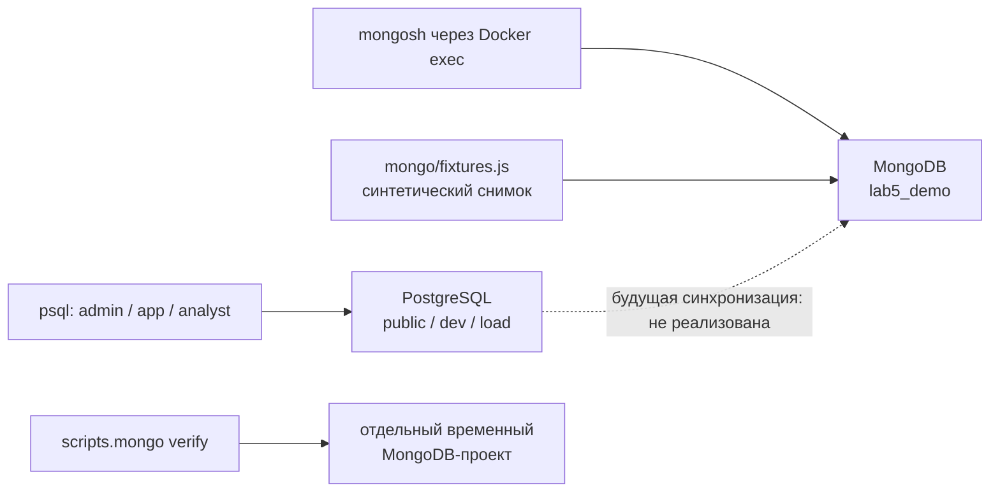
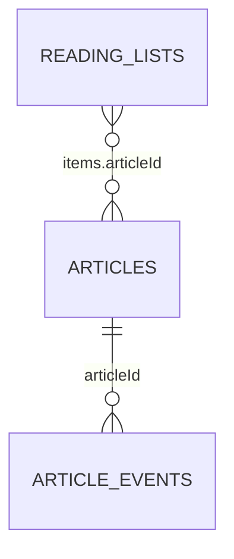

# Лабораторная работа 5 — Аналитические SQL-запросы и документная модель MongoDB

**Проект:** учебный агрегатор новостей.

**Среда проверки:** PostgreSQL 18.6, MongoDB 8.0.34, mongosh 2.14.0, Docker Compose v2, Python 3.10+ stdlib.

**Дата подготовки и проверки:** 4 ноября 2026 года.

Цель работы — завершить аналитическую часть PostgreSQL и разработать документную
модель, ориентированную на задачи новостного портала. Реализованы восемь
SQL-запросов, четыре коллекции MongoDB, встраивание и ссылки, CRUD и валидация.
Документная часть объединяет данные в карточки и подборки, а события и исходные
ответы источников хранит отдельно.

PostgreSQL продолжает хранить исходные новости, пользователей, подписки и историю
импорта. В MongoDB используются небольшие синтетические данные: они моделируют
снимок источника, но **автоматического обмена между базами сейчас нет**.
Это позволяет проверить документную модель, не изменяя данные предыдущих лабораторных.

## Содержание

1. [Требования и результат](#requirements)
2. [Устройство проекта и карта файлов](#structure)
3. [Подготовка, запуск и остановка](#startup)
4. [Общие принципы SQL-каталога](#sql-principles)
5. [Разбор каждого запроса Q1–Q8](#sql-catalog)
6. [Как запускать SQL-запросы и читать результаты](#sql-demo)
7. [Владение данными и источник истины](#ownership)
8. [Задачи документной модели](#document-tasks)
9. [Четыре коллекции и связи 1:N/M:N](#collections)
10. [Встраивание и ссылки: чтение, обновление, размер](#embedding-reference)
11. [CRUD каждой коллекции](#crud)
12. [Schema validation и три бизнес-правила](#validation)
13. [Автоматические проверки и фактические результаты](#verification)
14. [Семь артефактов сдачи и журнал решений](#artifacts)
15. [Маршрут демонстрации на защите](#defense)
16. [Типичные проблемы и их диагностика](#troubleshooting)
17. [Вопросы для самопроверки и границы работы](#questions)

<a id="requirements"></a>
## 1. Требования и результат

| Пункт задания | Что сделано | Где смотреть |
| --- | --- | --- |
| Дополнить каталог до восьми содержательных SQL-запросов | Q1–Q8 отвечают на вопросы о ленте, поиске, категориях, импорте и публикациях | [sql/queries](../sql/queries/), раздел 5 |
| Не менее трёх запросов с агрегатами | Пять: Q3, Q4, Q5, Q6, Q8 | `COUNT`, `MAX`, `SUM`, `AVG` |
| Не менее трёх запросов с оконными функциями | Три: Q6, Q7, Q8 | `DENSE_RANK`, `LAG`, оконные `SUM`/`AVG` |
| Ранжирование | Рейтинг источников внутри категории | Q6 |
| LAG или LEAD | Предыдущее время публикации того же источника | Q7 |
| Накопительный или скользящий агрегат | Реализованы оба | Q8 |
| Не менее двух запросов с CTE или подзапросами | Шесть: Q1, Q3, Q5, Q6, Q7, Q8 | `EXISTS`, `WITH` |
| Не менее пяти запросов с соединением нескольких таблиц | Q1–Q7 напрямую соединяют предметные таблицы; Q8 дополнительно соединяет источник, календарь и агрегат новостей | Каталог SQL |
| Разграничить PostgreSQL/MongoDB и источник истины | Таблица владения и правила производной карточки | Раздел 7 |
| Выбрать задачи с преимуществами документной модели | Карточка новости, сырые ответы, события, пользовательские подборки | Раздел 8 |
| Минимум три коллекции, 1:N и M:N | Четыре коллекции; статья→события и подборки↔статьи | Раздел 9 |
| Реализовать embedding и reference, обосновать выбор | Встроенные `items`, `source`, `categories`; ссылки `articleId` и чтение через `$lookup` | Раздел 10, [crud.js](../mongo/crud.js) |
| CRUD основных документов | C/R/U/D всех четырёх коллекций | Раздел 11 |
| Типы, обязательные поля и 2–3 бизнес-правила | Строгие BSON-типы и обязательность; три основных бизнес-правила | Раздел 12, [schema.js](../mongo/schema.js) |

Для сдачи подготовлены семь требуемых артефактов; их отдельная таблица находится
в [разделе 14](#artifacts). Этот отчёт объясняет их взаимосвязь и порядок демонстрации.

<a id="structure"></a>
## 2. Устройство проекта и карта файлов

### 2.1. Два независимых учебных стенда



Сплошные стрелки показывают реальные пути работы. Пунктир между PostgreSQL и
MongoDB — проектное направление для будущего обмена. Сейчас `fixtures.js`
сам создаёт демонстрационные документы, не подключаясь к PostgreSQL.

| Стенд | Compose-проект | Данные | Доступ |
| --- | --- | --- | --- |
| Основной PostgreSQL | `bd-news-labs` | `public`, `dev`, `load` | Клиенты Compose; порт хоста по умолчанию `127.0.0.1:55432` |
| Сохраняемый MongoDB-demo | `bd-news-mongo` | БД `lab5_demo`, именованные тома | Только `docker compose exec` в контейнер |
| MongoDB-проверка | `bd-news-mongo-check-<id>` | БД `lab5_check_<id>`, отдельные тома | Создаётся и удаляется обёрткой `verify` |

MongoDB запущена с `network_mode: none`, слушает `127.0.0.1` внутри контейнера
и не публикует порт на хосте. `mongosh` находится в том же образе `mongo:8.0`.
Поэтому здесь не нужен отдельный драйвер Python, установка MongoDB на хост
или новые пароли. Доступ к Docker считается доверенным; полноценная
аутентификация MongoDB-приложения в этом стенде не реализована.

### 2.2. Карта файлов

| Файл или каталог | Для чего нужен |
| --- | --- |
| [compose.yaml](../compose.yaml), [start.sh](../start.sh) | Запуск PostgreSQL, подготовка ролей и применение миграций |
| [sql/queries](../sql/queries/) | Единственные исполняемые исходники Q1–Q8 |
| [sql/query_parameters.sql](../sql/query_parameters.sql) | Значения параметров по умолчанию для psql |
| [run_queries.sql](../run_queries.sql) | Последовательно запускает восемь запросов в транзакции `READ ONLY` |
| [tests/queries.sql](../tests/queries.sql) | Контрольные данные и проверки результатов SQL |
| [scripts/verify.py](../scripts/verify.py) | Проверка SQL, миграций, ролей и прежних инвариантов в отдельной БД |
| [experiments/examples.py](../experiments/examples.py) | По пять строк реальных результатов каждого запроса на dev/42 |
| [mongo/compose.yaml](../mongo/compose.yaml) | Отдельный изолированный MongoDB-контейнер и тома |
| [scripts/mongo.py](../scripts/mongo.py) | Команды `up`, `demo`, `verify`, `down`, управление процессами и журналами |
| [mongo/schema.js](../mongo/schema.js) | Создание четырёх коллекций, их валидаторы и индексы |
| [mongo/fixtures.js](../mongo/fixtures.js) | Небольшой набор согласованных BSON-документов |
| [mongo/crud.js](../mongo/crud.js) | CRUD, встраивание, ссылки, чтение 1:N и M:N |
| [mongo/verify.js](../mongo/verify.js) | Позитивные, отрицательные и граничные проверки |
| [mongo/common.js](../mongo/common.js), [failure_probe.js](../mongo/failure_probe.js) | Утверждения, точные коды ошибок, проверка отказа процесса |
| [mongo/demo.js](../mongo/demo.js), [scenario.js](../mongo/scenario.js) | Точки входа и общий сценарий создания/проверки данных |
| [Модель MongoDB](kt-05-mongodb-docs.md) | Владение, коллекции, поля, связи и обоснование модели |
| [Журнал решений](kt-05-decisions.md) | Шесть ADR: причины выбора, альтернативы и последствия |

Python здесь запускает команды и проверяет их завершение. SQL и MongoDB-запросы
хранятся в своих файлах, поэтому демонстрация и автоматические проверки работают
с одной реализацией.

<a id="startup"></a>
## 3. Подготовка, запуск и остановка

### 3.1. Что нужно и откуда выполнять команды

Нужны работающий Docker с Compose v2, Python 3.10+ и shell. При первом запуске
потребуется скачать официальные образы `postgres:18` и `mongo:8.0`.
Все блоки `sh` в отчёте выполняются **из корня репозитория**, где лежит `start.sh`.
Блоки JavaScript, подписанные «в mongosh», выполняются в консоли MongoDB,
а не в обычном терминале.

Проверка инструментов:

<!-- check: shell prerequisites -->
```sh
docker compose version
python3 --version
```

Для работы с Docker у пользователя должен быть доступ к его daemon.
Пароли PostgreSQL задаёт `start.sh` в игнорируемом `.env`; содержимое этого
файла не нужно печатать или вставлять в команды отчёта.

### 3.2. PostgreSQL: запуск и начальные данные

<!-- check: shell postgres-start -->
```sh
sh start.sh
docker compose ps
```

`start.sh` создаёт отсутствующий `.env`, поднимает PostgreSQL, настраивает роли
и применяет недостающие миграции. Повторный запуск сохраняет данные и проверяет
контрольные суммы применённых миграций. Ожидается статус сервера `Healthy`.

Проверить наличие маленького набора в `public`:

<!-- check: shell public-count -->
```sh
docker compose run --rm -T admin -c 'SELECT count(*) AS news_count FROM public.news;'
```

**Только для новой базы с пустыми предметными таблицами** один раз выполнить:

```sh
docker compose run --rm -T seed_only
```

Seed создаёт пять новостей и связанные справочники/подписки/импорт. Повторное
наполнение уже занятой схемы не требуется. Нулевой результат запроса о новостях
сам по себе не доказывает, что все остальные таблицы пусты: на существующей
базе ориентируемся на историю её создания.

### 3.3. Данные dev для содержательной аналитики

`public` подходит для короткой демонстрации связей. Набор `dev/42` содержит
80 000 новостей и даёт содержательные рейтинги и временные ряды. Его опорная
дата — **2026-10-01 00:00:00 UTC**. Наличие и параметры схемы проверяются без изменений:

<!-- check: shell dev-metadata -->
```sh
docker compose run --rm -T admin -c "SELECT nspname, obj_description(oid, 'pg_namespace') AS dataset FROM pg_namespace WHERE nspname = 'dev';"
```

Если схемы нет либо нужен именно новый dev/42, выполнить отдельно:

```sh
sh generator/run.sh dev 42
```

Эта команда **заменяет только схему dev**, `public` и `load` сохраняются.
Генерацию выполнять последовательно, без параллельных замеров. Для лабораторной 5
не требуется заново создавать многомиллионный `load`. При подготовке этого отчёта
использован уже существующий dev/42, пользовательский набор не пересоздавался.

### 3.4. MongoDB: демонстрация и автоматическая проверка

Запуск демонстрации:

<!-- check: shell mongo-demo -->
```sh
python3 -m scripts.mongo demo
```

Команда запускает контейнер, **пересоздаёт только учебную `lab5_demo`**,
создаёт схему и документы, выполняет CRUD и оставляет итоговый набор для просмотра.
В конце должны быть `20 проверок` и `PASS: MongoDB demo`.
После сценария остаются 2 статьи, 2 события, 1 payload и 2 подборки.
Повторный `demo` возвращает этот состав, при этом автоматически созданные ObjectId
могут отличаться.

Полная проверка в отдельном временном проекте:

<!-- check: shell mongo-verify -->
```sh
python3 -m scripts.mongo verify
```

Она выполняет тот же CRUD, затем негативные и граничные случаи. Ожидаемый итог —
170 утверждений, три ожидаемых отказа процессов с exit=1 и общий `PASS: MongoDB verify`
с exit=0. Временные контейнер и тома удаляются. Сохранённая `lab5_demo` не меняется.

### 3.5. Остановка и продолжение работы

После завершения демонстрации MongoDB можно остановить с сохранением данных:

<!-- check: shell mongo-restart -->
```sh
python3 -m scripts.mongo down
python3 -m scripts.mongo up
```

`up` только запускает контейнер; он не сбрасывает `lab5_demo`. Именно `demo`
пересоздаёт учебную БД. PostgreSQL останавливается отдельно:

```sh
docker compose stop postgres
```

Для продолжения PostgreSQL снова выполнить `sh start.sh`.
Для этой лабораторной удаление основного PostgreSQL-тома не требуется.

<a id="sql-principles"></a>
## 4. Общие принципы SQL-каталога

### 4.1. Агрегат, окно, CTE и соединение решают разные задачи

`GROUP BY` собирает несколько строк в группу, а `COUNT`, `MAX`, `SUM` и другие
агрегаты вычисляют её характеристику. Например, Q6 сначала превращает новости
в число публикаций каждой пары «категория–источник».

Оконная функция с `OVER` вычисляет значение для строки с учётом связанных строк,
сохраняя их отдельными в результате. `PARTITION BY` разделяет расчёт на группы,
`ORDER BY` внутри окна задаёт порядок расчёта. Итоговый `ORDER BY` управляет
порядком вывода и может быть другим: в Q7 предшественника ищем по времени,
но показываем результаты по длительности паузы.
[Объяснение PostgreSQL](https://www.postgresql.org/docs/18/tutorial-window.html).

CTE с `WITH` даёт имя промежуточному результату. В проекте это помогает разделить
подсчёт, расчёт окна и фильтрацию. В Q1 используется коррелированный подзапрос
`EXISTS`: он отвечает на вопрос о существовании подходящей подписки.

`JOIN` связывает сущности. `LEFT JOIN` сохраняет левую строку даже при отсутствии
связанных данных. `WHERE` фильтрует строки до группировки, `HAVING` — уже
вычисленные группы; последнее используется в Q5.

### 4.2. Параметры

Значения определены в [query_parameters.sql](../sql/query_parameters.sql).
Переданные через `psql -v` значения имеют приоритет: файл задаёт только отсутствующие.

| Параметр | По умолчанию | Где используется |
| --- | --- | --- |
| `as_of` | Текущее `now()` | Q1, Q3–Q8 |
| `user_id` | 1 | Q1 и контекст RLS |
| `window_days` | 30 | Q1, Q3, Q6, Q7, Q8 |
| `page_size`, `page_offset` | 20, 0 | Q1, Q7 |
| `search_text`, `category_name` | `матч`, `Спорт` | Q2 |
| `date_from` | `2026-01-01 00:00:00+00` | Q4 |
| `days`, `min_failed_runs` | 7, 1 | Q5 |
| `top_ranks` | 3 | Q6 |
| `source_id` | 1 | Q8 |

Числовые параметры задаются корректными целыми: размеры и число мест положительные,
смещение неотрицательное. Это параметры учебного psql-клиента, не HTTP API.

### 4.3. Временные границы

Q1, Q3, Q6 и Q7 используют интервал `[as_of − window_days суток, as_of)`:
нижняя граница включается, верхняя исключается. Q5 аналогично использует `days`,
Q4 — `[date_from, as_of)`. Такие окна не дублируют событие на общей границе
двух соседних периодов. Q2 временного фильтра не имеет.

**Q8 отличается:** он берёт `window_days` полных суток UTC до UTC-даты `as_of`.
Для `as_of=2026-10-01 12:00:00+00` весь текущий день 1 октября исключается;
30-дневный результат — 1–30 сентября. Это позволяет сравнивать полные дни.

Для исторического dev надо явно передавать опорную дату. Если использовать `now()`
через несколько месяцев, пустой результат недавних публикаций будет логически
правильным, но неудобным для демонстрации.

### 4.4. Роли

| Запрос | Подходящая роль | Причина |
| --- | --- | --- |
| Q1 | `news_app` с `SET LOCAL app.current_user_id`; admin для контроля | Читает персональные подписки |
| Q2 | app / analyst / admin | Только публикации и справочники |
| Q3 | admin | Нужны все подписки для глобальной статистики |
| Q4–Q8 | analyst / admin | Общедоступные предметные данные и метрики сбора |

Общий сервис `queries` использует администратора: иначе Q3 не получил бы полную
статистику. Q1 дополнительно проверен под настоящим логином приложения.
Переданный `user_id` должен соответствовать авторизованному пользователю доверенного
приложения; сам SQL-параметр не доказывает личность.

<a id="sql-catalog"></a>
## 5. Разбор каждого запроса Q1–Q8

### 5.1. Q1 — персонализированная лента

**Файл:** [q1_personal_feed.sql](../sql/queries/q1_personal_feed.sql).

**Вопрос:** какие новости показать пользователю в первую очередь?

Запрос соединяет `news` с `news_source`, ограничивает даты и вычисляет
`is_priority`. Приоритет даёт подписка на неотключённый источник или на активную
обычную категорию статьи. Источники со статусами «неактивен» и «отключён вручную»
не дают приоритета через подписку; служебная категория «Без категории» также
не даёт его через категорию.

Оба признака вычисляются через `EXISTS`. Если у статьи несколько подходящих
категорий, результат остаётся одной строкой: соединение подписок прямо с
главным набором могло бы размножить новости. Сортировка: приоритетные сначала,
затем `published_at DESC, id DESC`; в конце применяются `LIMIT/OFFSET`.

**Что объяснить:** приоритет влияет на порядок, а не исключает все остальные
новости. Новость без подходящей подписки остаётся во второй части ленты.
ID разрешает равенство времён и делает порядок однозначным на фиксированном наборе.

### 5.2. Q2 — поиск внутри категории

**Файл:** [q2_search_by_category.sql](../sql/queries/q2_search_by_category.sql).

**Вопрос:** какие новости выбранной категории содержат заданный текст?

Соединяются `news`, `news_source`, `news_category`, `category`. Категория
сравнивается по имени, а заголовок и содержание проверяются через `ILIKE`
с `%` по краям поискового текста. `OR` означает: достаточно совпадения
в заголовке **или** тексте. Результат сортируется по времени и ID.

Это поиск по шаблону без учёта регистра, без морфологического разбора.
Символы `%` и `_` в `search_text` сохраняют смысл шаблона SQL.
Запрос не ограничен периодом и сам не вводит пагинацию. `examples.py` показывает
первые пять строк только для компактного примера, не меняя канонический Q2.

**Что объяснить:** таблица `news_category` нужна для M:N между новостями и
категориями. `JOIN news_source` добавляет человеку читаемое имя источника.

### 5.3. Q3 — статистика категорий без перемножения строк

**Файл:** [q3_category_popularity.sql](../sql/queries/q3_category_popularity.sql).

**Вопрос:** сколько публикаций и подписчиков у каждой категории и когда была
последняя публикация?

Первый CTE `category_news` считает новости за период и максимальное время
публикации. Второй `category_subscribers` считает все текущие подписки категории;
для подписок временного фильтра здесь нет. Два уже агрегированных набора
присоединяются к `category` через `LEFT JOIN`. `coalesce(..., 0)` превращает
отсутствующие счётчики в нули; время последней новости остаётся `NULL`.

**Почему два CTE:** если сначала соединить две новости категории с тремя
подписчиками, получится шесть строк. Простой `COUNT(*)` дал бы неверную
статистику. Раздельная агрегация обеспечивает по одной строке на категорию
до соединения и устраняет эту ошибку.

На dev/42 за сентябрь категория «Спорт» имеет **13 452 новости и 2 747 подписчиков**.
Служебные и неактивные категории запрос не исключает: это полная статистика
справочника. Глобальный подсчёт выполняется администратором из-за персональных подписок.

### 5.4. Q4 — статистика импорта по источникам

**Файл:** [q4_source_import_stats.sql](../sql/queries/q4_source_import_stats.sql).

**Вопрос:** сколько запусков было у источника и как обработаны полученные материалы?

`news_source LEFT JOIN scrape_run LEFT JOIN import_result` сохраняет источники
без запусков и запуски без материалов. Ограничения времени стоят в `ON`
соединения запусков: перенос в `WHERE` исключил бы строки без запуска.

Один запуск может иметь несколько результатов, поэтому для `runs` используется
`COUNT(DISTINCT r.id)`. Остальные показатели — `COUNT(ir.id) FILTER (...)` для
статусов «успех», «дубликат», «ошибка». `COUNT(ir.id)` не считает строку с NULL
после отсутствующего правого соответствия.

При `date_from=2026-01-01`, `as_of=2026-10-01` источник 1 на dev/42 имеет
**274 запуска, 10 588 успешных материалов, 857 дубликатов и 208 ошибок материалов**.
Ошибка отдельного материала и ошибка всего запуска сбора — разные события;
Q5 отвечает на второй вопрос.

### 5.5. Q5 — источники для диагностики

**Файл:** [q5_problem_sources.sql](../sql/queries/q5_problem_sources.sql).

**Вопрос:** какие источники имеют не менее N неудачных запусков за период?

CTE `failed` выбирает `scrape_run.status='ошибка'` и группирует журнал по запуску.
Один запуск может иметь несколько сообщений ошибки, а может не иметь ни одного.
`LEFT JOIN` сохраняет последний случай: факт неудачного запуска существует
независимо от подробности журнала.

Внешний запрос группирует уже по источнику. `COUNT(*)` теперь считает запуски,
`SUM(error_records)` — сообщения, `MAX(last_error_at)` — последнее время
журнала. `HAVING count(*) >= :min_failed_runs` оставляет нужные группы.

На dev/42 у источника 81 за последнюю неделю **3 неудачных запуска и 3 сообщения**.
Это не доказательство трёх ошибок подряд: Q5 не проверяет последовательность
между успешными запусками и самостоятельно не отключает источник.

### 5.6. Q6 — рейтинг источников внутри категории

**Файл:** [q6_category_source_ranking.sql](../sql/queries/q6_category_source_ranking.sql).

**Вопрос:** какие источники дали больше публикаций по каждой теме?

1. `source_counts` соединяет категории, их новости и источники, выбирает период
   и считает публикации пары «категория–источник».
2. `ranked` вычисляет `DENSE_RANK` отдельно внутри каждой категории.
3. Внешний запрос оставляет `source_rank <= top_ranks` и задаёт стабильный вывод.

Ключевой фрагмент реализации, не отдельная команда:

```sql
dense_rank() OVER (
    PARTITION BY category_id ORDER BY news_count DESC
) AS source_rank
```

Включены активные категории, кроме «Без категории». Одна новость с несколькими
категориями учитывается в каждой соответствующей категории. Текущий статус
источника не исключает его ранее сохранённые статьи. Источник без публикаций
в этой категории за период в рейтинг не входит.

При равных количествах источники делят место. ID не включается в сортировку
внутри окна: иначе он искусственно разделил бы равные результаты.

| Количество новостей | DENSE_RANK | RANK | ROW_NUMBER при выбранном порядке равных |
| ---: | ---: | ---: | ---: |
| 3 | 1 | 1 | 1 |
| 3 | 1 | 1 | 2 |
| 1 | 2 | 3 | 3 |

Следовательно, `top_ranks=1` может вернуть двух лидеров, а `top_ranks=2` — все
три строки. Это ограничение **мест**, а не числа источников.
[Семантика функций ранжирования](https://www.postgresql.org/docs/18/functions-window.html).

Пример dev/42 для «Политики»: источник 3 — **1952** новости, место 1;
источник 5 — **1935**, место 2; источник 4 — **1897**, место 3.

### 5.7. Q7 — интервалы между публикациями

**Файл:** [q7_source_publication_gaps.sql](../sql/queries/q7_source_publication_gaps.sql).

**Вопрос:** между какими публикациями одного источника были наиболее длинные паузы?

Сначала выбирается период. Затем для каждой строки `LAG(published_at)` получает
предыдущее время того же источника. Ключевой фрагмент:

```sql
lag(n.published_at) OVER (
    PARTITION BY n.source_id ORDER BY n.published_at, n.id
) AS previous_published_at
```

Разность `published_at - previous_published_at` даёт interval. У первой новости
**внутри выбранного периода** предшественник равен `NULL`, даже если до начала
периода у источника были статьи. Две одновременные новости упорядочены по ID;
между ними получается нулевой интервал.

Результат сортируется по `publication_gap DESC NULLS LAST`, затем по времени
и ID. Пагинация находится после CTE: сначала рассчитывается предшественник,
потом выбирается страница. Иначе начало страницы ошибочно выглядело бы
первой новостью источника.

На dev/42 публикация **55290**, источник 58: предыдущая публикация
`2026-09-11 13:10:05+00`, текущая `2026-09-21 11:49:07+00`, пауза
**9 days 22:39:02**. Запрос не измеряет текущий простой после последней новости
и не доказывает отказ HTTP-источника: он анализирует сохранённые времена публикаций.

### 5.8. Q8 — дневная динамика, накопление и скользящее среднее

**Файл:** [q8_source_daily_trend.sql](../sql/queries/q8_source_daily_trend.sql).

**Вопрос:** как меняется ежедневный объём публикаций выбранного источника?

`bounds` получает UTC-дату верхней границы. `daily_counts` считает новости
каждого полного дня. `calendar` генерирует все дни периода, после чего
`LEFT JOIN` и `COALESCE` добавляют нули на дни без публикаций.

Окна рассчитываются по этому непрерывному календарю:

```sql
sum(coalesce(n.news_count, 0)) OVER (
    ORDER BY c.day ROWS BETWEEN UNBOUNDED PRECEDING AND CURRENT ROW
) AS cumulative_news
```

```sql
round(avg(coalesce(n.news_count, 0)) OVER (
    ORDER BY c.day ROWS BETWEEN 6 PRECEDING AND CURRENT ROW
), 2) AS moving_avg_7_days
```

Первое окно берёт все строки с начала периода до текущего дня. Второе — текущую
и шесть предыдущих строк. Здесь строка соответствует календарному дню,
потому что пропуски предварительно заполнены. Без календаря это было бы
среднее по семи дням **с публикациями**, что отвечает на другой вопрос.

В первые шесть дней скользящее окно короче семи строк. История до начала периода
не подгружается и не дополняется нулями. Накопительный итог также начинается
с начала выбранного периода, а не с первой новости за всё время.

Первые дни источника 1 на dev/42:

| День | Новостей | Накопительно | Скользящее среднее |
| --- | ---: | ---: | ---: |
| 2026-09-01 | 126 | 126 | 126.00 |
| 2026-09-02 | 112 | 238 | 119.00 |
| 2026-09-03 | 114 | 352 | 117.33 |
| 2026-09-04 | 103 | 455 | 113.75 |
| 2026-09-05 | 128 | 583 | 116.60 |

На 30 сентября: 931 публикация за день, **9362 накопительно**, среднее **946.86**.
Существующий источник без новостей получает нулевой календарь, неизвестный
`source_id` — пустой результат. Часовой пояс сессии не меняет границы UTC.

<a id="sql-demo"></a>
## 6. Как запускать SQL-запросы и читать результаты

### 6.1. Все восемь на маленьком public

После запуска и начального seed:

<!-- check: shell sql-catalog -->
```sh
docker compose run --rm -T queries
```

Должны появиться заголовки q1–q8, затем `All queries completed successfully`
и `COMMIT`. Пустая выборка отдельного запроса допустима: это зависит от дат
и параметров. SQL-ошибка останавливает psql благодаря `ON_ERROR_STOP=1`.

### 6.2. Поиск под аналитиком

<!-- check: shell sql-search -->
```sh
docker compose run --rm -T analyst -v search_text=матч -v category_name=Спорт \
  -f /workspace/sql/query_parameters.sql \
  -f /workspace/sql/queries/q2_search_by_category.sql
```

В public после стандартного seed есть статья «Обзор матча Лиги Чемпионов».
Категория и текст передаются как параметры; полный запрос берётся из файла.

### 6.3. Лента под настоящим news_app

<!-- check: shell sql-app-feed -->
```sh
docker compose run --rm -T app -v user_id=1 <<'SQL'
\ir /workspace/sql/query_parameters.sql
BEGIN READ ONLY;
SET LOCAL app.current_user_id TO :'user_id';
\ir /workspace/sql/queries/q1_personal_feed.sql
COMMIT;
SQL
```

`SET LOCAL` действует только до конца транзакции. В демонстрации используется
учебный пользователь 1. В настоящем приложении ID должен поступать из
проверенного контекста авторизации.

### 6.4. Три оконных запроса на dev/42

<!-- check: shell sql-windows -->
```sh
docker compose run --rm -T analyst \
  -v as_of='2026-10-01 00:00:00+00' -v window_days=30 \
  -v top_ranks=3 -v page_size=5 -v source_id=1 \
  -c "SET search_path TO dev, public; SET timezone TO 'UTC';" \
  -f /workspace/sql/query_parameters.sql \
  -f /workspace/sql/queries/q6_category_source_ranking.sql \
  -f /workspace/sql/queries/q7_source_publication_gaps.sql \
  -f /workspace/sql/queries/q8_source_daily_trend.sql
```

Команда выполняет Q6, Q7 и Q8 последовательно в одной сессии. Для Q7 ограничение
пятью строками — параметр страницы; для Q8 возвращаются все 30 суток.
Сначала убедиться, что схема dev существует: иначе `search_path` может использовать
public, и это будет другой набор данных.

### 6.5. Проверки и воспроизводимые примеры

<!-- check: shell sql-verify -->
```sh
python3 -m scripts.verify
```

Команда создаёт отдельную SQL-БД, проверяет миграции, ограничения, сценарии,
роли, RLS/аудит и запросы, затем удаляет эту БД. В `tests/queries.sql`
подставляется SQL из канонических файлов. Контрольные ожидания проверяют
результат, включая равные места, временные границы и пустые сутки.

Получить по пять строк примера каждого запроса на dev/42:

<!-- check: shell sql-examples -->
```sh
python3 -m experiments.examples
```

Восемь файлов создаются в `artifacts/queries/`. Время, приводимое в прежней
лабораторной 3, не используется здесь как новая оценка скорости Q6–Q8:
в пятой работе проверяется содержательная корректность каталога.

<a id="ownership"></a>
## 7. Владение данными и источник истины

**Источник истины** — база, чьё значение считается правильным при расхождении
копий. **Проекция** — производная форма данных для определённого чтения;
её можно восстановить из источника. Наличие поля в MongoDB само по себе
не делает MongoDB владельцем этого факта.

| Данные | Авторитетное хранилище | Роль MongoDB |
| --- | --- | --- |
| `app_user`, `role` | PostgreSQL | Хранятся только числовые ссылки на пользователей, без паролей и хешей |
| `news`, `news_category` | PostgreSQL | `articles` содержит производную карточку новости |
| `news_source`, `category` | PostgreSQL | Имена и ID входят в снимки `source`/`categories` карточки |
| Подписки, `favorite` | PostgreSQL | Персональные ограничения RLS остаются в PostgreSQL |
| `scrape_run`, `import_result`, `scrape_error_log` | PostgreSQL | Payload содержит ссылки на запуск и источник |
| Аудит, журнал миграций | PostgreSQL | Не переносятся |
| Сырой ответ поставщика | MongoDB `import_payloads` | Самостоятельный документ переменной структуры |
| Просмотр или переход по новости | MongoDB `article_events` | Самостоятельное событие |
| Именованная подборка с заметками | MongoDB `reading_lists` | Самостоятельный пользовательский документ |

### 7.1. Почему исходная новость остаётся в PostgreSQL

На `news` уже ссылаются категории, избранное и результаты импорта. Q1–Q8
строятся на этих таблицах, а транзакция импорта должна согласованно сохранять
несколько связанных сущностей. Перенос исходной новости потребовал бы изменения
этих гарантий и всего SQL-каталога.

Карточка `articles` решает другую задачу: получить заголовок, текст, источник
и названия категорий как один документ. Её `_id` соответствует `news.id`.
`canonicalUrl`, `title`, `content`, `publishedAt` берутся из news; source —
из news_source; categories — из связи news_category с category.
Поле автора поставщика пока относится к `import_payloads.raw`, поскольку
такого поля в текущей SQL-модели новости нет.

### 7.2. Что означают изменения и удаления копии

Будущая публикация карточки должна происходить после COMMIT исходного импорта.
Ошибка записи в MongoDB не может отменить уже завершённый COMMIT PostgreSQL.
Поэтому одной команды «записать после COMMIT» недостаточно для гарантированной
доставки: нужна повторная сверка или другая стратегия восстановления.

В модели предусмотрена пересборка по одному `news.id` с тем же `_id`.
Изменения имён источника и категорий тоже должны обновить соответствующие копии.
Удаление исходной новости отражается `deletedAt`: это время обнаружения удаления
при сверке, не точное время исходного SQL DELETE. Реальная сверка пока не написана.

В учебном CRUD статья создаётся и обновляется как будто пришёл новый исходный
снимок, затем демонстрируется `deletedAt` и удаление временной копии.
Это проверяет операции MongoDB, но не доказывает работающую синхронизацию БД.

### 7.3. Подборки и избранное не имеют общего владельца

`favorite` — уже существующая SQL-связь пользователя с новостью. `reading_lists`
добавляет отдельную функцию: у пользователя несколько именованных списков,
у каждого элемента дата добавления и заметка. Подборки не заменяют favorite
и не создают вторую редактируемую копию SQL-подписки или избранного.

PostgreSQL RLS не действует на MongoDB. Фильтр `userId` в CRUD показывает,
как выбирать документ владельца, но доверять ID можно только после внешней
аутентификации клиента. В данном стенде пользователь с Docker-доступом доверенный.

<a id="document-tasks"></a>
## 8. Задачи документной модели

| Задача | Характер данных и доступа | Почему выбрана такая форма | Цена решения |
| --- | --- | --- | --- |
| Карточка новости | Текст, источник и категории обычно читаются вместе | Вложенные снимки позволяют получить карточку одним чтением | Дублирование названий и необходимость пересборки копии |
| Исходные ответы источников | У разных поставщиков разные поля и вложенность | `raw` сохраняет форму JSON-ответа либо исходный RSS-текст | Для осмысленной обработки всё равно нужен парсер и контракт format |
| События по новостям | События разных типов дописываются независимо, число растёт | Отдельные документы с articleId и расширяемым details | Для объединения со статьёй нужен дополнительный поиск или lookup |
| Пользовательские подборки | Список с датами и заметками читается целиком и имеет ограниченный размер | Элементы удобно встроить, изменение заметки выполняется внутри документа | Нужен предел роста, тексты статей лучше получать отдельно |

Документная модель здесь не повторяет каждую SQL-таблицу отдельной коллекцией:
`articles` объединяет несколько реляционных сущностей, `reading_lists` хранит
целую подборку с элементами, а `raw` допускает переменную вложенную структуру.
PostgreSQL также поддерживает JSONB; выбор MongoDB объясняется задачами этой
лабораторной и формой документов. Ускорение относительно PostgreSQL в этой
работе не измерялось и не заявляется.

<a id="collections"></a>
## 9. Четыре коллекции и связи 1:N/M:N

### 9.1. BSON-типы

MongoDB хранит BSON. В отличие от обычного JSON, в нём явно различаются long,
int, date и ObjectId. Поэтому в сценариях используются конструкторы:

| В коде mongosh | BSON-тип | Применение |
| --- | --- | --- |
| `NumberLong("1000")` | 64-битное целое | news/article/user/scrapeRun ID, соответствующие SQL BIGINT |
| `NumberInt(2)` | 32-битное целое | ID источника и категории, соответствующие SQL INTEGER |
| `ISODate("2026-10-02T09:00:00Z")` | date | Времена публикации, события, получения и добавления |
| `ObjectId()` | objectId | Собственные ID событий, payload и подборок |

Строка `"1000"` и числовой long — разные типы. Обычная строка даты тоже
не является BSON date. Для длинных ID аргумент NumberLong передаётся строкой,
чтобы сначала не потерять точность при представлении большого числа в JavaScript.
`EJSON.stringify(document, null, 2, {relaxed: false})` показывает типы как `$numberLong`,
`$numberInt`, `$date`, `$oid`. [Extended JSON](https://www.mongodb.com/docs/manual/reference/mongodb-extended-json/).

### 9.2. articles — карточка новости

| Поле | Тип и смысл |
| --- | --- |
| `_id` | long, положительный ID исходной новости |
| `canonicalUrl` | непустая HTTP(S)-строка до 500 символов, уникальный индекс |
| `title`, `content` | строки хотя бы с одним непробельным символом |
| `publishedAt` | date |
| `source` | объект с обязательными `id: int`, `name: string` |
| `categories` | непустой массив объектов `id/name` |
| `deletedAt` | date или null, поле обязательно |

Все поля таблицы обязательны. Дополнительные поля верхнего уровня запрещены;
вложенные справочники тоже имеют заданную форму. Наличие обязательного `deletedAt`
с `null` показывает, что карточка считается действующей.

### 9.3. article_events — события статьи

Обязательные поля: `_id: objectId`, `articleId: long`, `userId: long|null`,
`type` со значениями `view`/`click`, `at: date`. Необязательный `details` — объект
для дополнительных сведений события. Даже у гостя поле `userId` присутствует,
но имеет значение `null`.

Индекс `{articleId: 1, at: -1}` соответствует чтению истории одной статьи по времени.
События находятся в отдельных документах: новая запись не переписывает карточку.

### 9.4. import_payloads — исходные ответы

Обязательные поля: `_id: objectId`, `scrapeRunId: long`, `sourceId: int`,
`format`, `receivedAt: date`, `raw`. Для `json_api` raw — объект, для `rss` —
непустая строка. Вложенные ключи raw не унифицируются между поставщиками.

Индекс `{scrapeRunId: 1, receivedAt: 1}` помогает получить исходные материалы
запуска по времени. Сам запуск остаётся сущностью PostgreSQL.
MongoDB проверяет тип ссылки, но не наличие запуска и совпадение его source_id.
Эта межбазовая проверка относится к будущей интеграции.

### 9.5. reading_lists — подборки

Обязательные поля: `_id: objectId`, `userId: long`, непустое `name` длиной
до 100 символов и массив `items`. Массив может быть пустым, максимум — 200 элементов.
Каждый элемент содержит обязательные `articleId: long`, `addedAt: date`
и необязательную строку `note` до 1000 символов.

Индекс `userId` обслуживает список подборок владельца. Индекс `items.articleId`
позволяет искать подборки, содержащие конкретную статью. Он обычный multikey;
запрет повтора статьи **внутри одной подборки** реализован валидатором, а не этим индексом.

### 9.6. Связи и фактический набор



Это логические связи по значениям полей, не автоматически обеспеченные FK.
После demo статья 1000 имеет два события: `view` и `click` — пример **1:N**.
Подборка A содержит 1000 и 1001, подборка B — 1000. Одна подборка содержит
несколько статей, статья входит в несколько подборок — пример **M:N**.

Дополнительные проектные связи: пользователь PostgreSQL→подборки — 1:N;
запуск PostgreSQL→payloads — 1:N. Для исходной новости и действующей карточки
предполагается 1:1, но при будущей асинхронной доставке копия временно может
отсутствовать. После удаления исходной новости копия может остаться как tombstone с deletedAt.

### 9.7. Просмотр реальных документов

Открыть mongosh после `demo`:

```sh
docker compose -f mongo/compose.yaml -p bd-news-mongo exec mongo \
  mongosh --quiet --norc lab5_demo
```

Внутри mongosh выполнить следующий блок. Для проверяемого отчёта он также
может исполняться целиком через `--eval`; `toArray()` явно получает результаты курсора.

<!-- check: mongo inspect-documents -->
```javascript
{
  const d = db.getSiblingDB("lab5_demo");
  for (const name of d.getCollectionNames().sort()) {
    print(name + ": " + d.getCollection(name).countDocuments({}));
    print(EJSON.stringify(d.getCollection(name).findOne(), null, 2, {relaxed: false}));
  }
}
```

Ожидаемые количества: articles=2, article_events=2, import_payloads=1,
reading_lists=2. Выход из mongosh — `exit` или Ctrl+D.

<a id="embedding-reference"></a>
## 10. Встраивание и ссылки: чтение, обновление, размер

### 10.1. Встраивание

`items` — часть документа подборки. При чтении списка пользователь сразу
получает даты и заметки. `$push` добавляет элемент, `$set` с `arrayFilters`
меняет заметку нужной статьи, не заменяя список целиком в клиентском коде.
Одна такая запись атомарна на уровне документа; последовательность нескольких
запросов в CRUD-файле не является общей транзакцией.

Вложенные source/categories в карточке также читаются вместе с ней. Их цена —
денормализация: при изменении названия категории все затронутые копии потребуется
перестроить. Это допустимо для проекции, потому что авторитетный справочник
сохраняется в PostgreSQL.

### 10.2. Ссылки

`article_events.articleId` ссылается на `articles._id`. Число событий может
расти без изменения размера карточки. Ссылки `items[].articleId` позволяют
использовать один текст новости во многих подборках.

Прочитать статью и её события, затем подборки и карточки статей — в mongosh:

<!-- check: mongo relationships -->
```javascript
{
  const d = db.getSiblingDB("lab5_demo");
  const article = d.articles.aggregate([
    {$match: {_id: NumberLong("1000")}},
    {$lookup: {from: "article_events", localField: "_id", foreignField: "articleId", as: "events"}}
  ]).toArray()[0];
  if (!article || article.events.length !== 2) throw new Error("Нарушен пример 1:N");
  print("Событий статьи 1000: " + article.events.length);
  const lists = d.reading_lists.aggregate([
    {$lookup: {from: "articles", localField: "items.articleId", foreignField: "_id", as: "cards"}},
    {$sort: {_id: 1}}
  ]).toArray();
  if (lists.length !== 2 || lists[0].cards.length !== 2 || lists[1].cards.length !== 1) {
    throw new Error("Нарушен пример M:N");
  }
  print(EJSON.stringify(lists, null, 2, {relaxed: false}));
}
```

`$lookup` выполняет чтение связанных документов, но не создаёт ограничения
ссылочной целостности. Удаление статьи не удаляет автоматически её события или
элементы списков. Эти правила должен реализовать отдельный слой приложения.

### 10.3. Почему размер является частью решения

MongoDB ограничивает BSON-документ 16 МиБ. Неограниченно растущий массив событий
внутри карточки со временем приблизил бы её к лимиту. Поэтому события вынесены.
У подборки рост ограничен: 200 элементов, до 1000 символов в заметке и до 100
в имени. [Лимит BSON](https://www.mongodb.com/docs/manual/reference/limits/#bson-document-size).

В реальном тесте подборка с 200 длинными кириллическими заметками заняла
**411 551 байт**. Размер измерен серверным `$bsonSize`, а не длиной строки JSON.
Проверка находится в `mongo/verify.js`. Это результат конкретного набора;
представление Unicode и значения полей влияют на число байтов.

Размер текущих небольших подборок можно прочитать так:

<!-- check: mongo bson-size -->
```javascript
printjson(db.getSiblingDB("lab5_demo").reading_lists.aggregate([
  {$project: {name: 1, items: {$size: "$items"}, bsonBytes: {$bsonSize: "$$ROOT"}}}
]).toArray());
```

У них будут другие, меньшие размеры. Набор для граничного измерения создаётся
только внутри verify и удаляется после проверки.

<a id="crud"></a>
## 11. CRUD каждой коллекции

### 11.1. Что выполняет общий сценарий

CRUD означает Create, Read, Update, Delete. Каждый шаг в
[crud.js](../mongo/crud.js) подтверждается чтением или количеством изменённых строк.

| Коллекция | Create / Read | Update | Delete |
| --- | --- | --- | --- |
| articles | Временная карточка исходной новости | Новый заголовок снимка, затем deletedAt | Удаление учебной копии |
| article_events | Новое событие просмотра | Обезличивание userId в null | Удаление временного события |
| import_payloads | Сохранение и чтение RSS-ответа | Исправление ошибочно записанного raw | Удаление временного ответа |
| reading_lists | Новый список со встроенным элементом | Добавление статьи, изменение её заметки | Удаление по ID и владельцу |

`demo.js` и `verify.js` вызывают один `scenario.js`, который загружает
schema, fixtures и crud. Поэтому проверяется именно тот сценарий, который
показывается на демонстрации. Примеры ниже позволяют вручную повторить логику;
канонический общий сценарий остаётся в файле.

Все следующие блоки выполнять **в mongosh после demo**. Каждый создаёт отдельный
временный документ и удаляет его в `finally`. Скобки `{ ... }` ограничивают
область имён, поэтому блок можно выполнить повторно в той же консоли.

### 11.2. articles: обновление проекции

<!-- check: mongo crud-articles -->
```javascript
{
  const c = db.getSiblingDB("lab5_demo").articles;
  const id = NumberLong("9000001");
  if (c.findOne({_id: id})) throw new Error("Учебный ID уже занят; существующий документ сохранён");
  try {
    c.insertOne({
      _id: id, canonicalUrl: "https://report.example/news/9000001",
      title: "Исходный заголовок", content: "Учебный текст",
      publishedAt: ISODate("2026-10-01T10:00:00Z"),
      source: {id: NumberInt(2), name: "Источник"},
      categories: [{id: NumberInt(2), name: "Спорт"}], deletedAt: null
    });
    printjson(c.findOne({_id: id}));
    c.updateOne({_id: id}, {$set: {title: "Уточнение из исходного снимка"}});
    if (c.findOne({_id: id}).title !== "Уточнение из исходного снимка") throw new Error("Update не выполнен");
    c.updateOne({_id: id}, {$set: {deletedAt: ISODate("2026-10-03T00:00:00Z")}});
    if (c.countDocuments({_id: id, deletedAt: null}) !== 0) throw new Error("Карточка осталась активной");
    if (c.deleteOne({_id: id}).deletedCount !== 1 || c.findOne({_id: id})) throw new Error("Delete не выполнен");
    print("PASS: articles C/R/U/D");
  } finally {
    c.deleteOne({_id: id});
  }
}
```

В production-проекции пользователь не должен независимо исправлять текст
копии. Здесь изменение заголовка моделирует новое значение из источника истины.
Физическое удаление используется только для временного документа демонстрации;
deletedAt показывает предусмотренное моделью отражение удаления из источника.

### 11.3. article_events: запись и обезличивание события

<!-- check: mongo crud-events -->
```javascript
{
  const c = db.getSiblingDB("lab5_demo").article_events;
  const id = ObjectId();
  try {
    c.insertOne({_id: id, articleId: NumberLong("1000"), userId: NumberLong("1"),
      type: "view", at: ISODate("2026-10-02T08:15:00Z")});
    printjson(c.findOne({_id: id}));
    c.updateOne({_id: id}, {$set: {userId: null}});
    if (c.findOne({_id: id}).userId !== null) throw new Error("Событие не обезличено");
    if (c.deleteOne({_id: id}).deletedCount !== 1 || c.findOne({_id: id})) throw new Error("Delete не выполнен");
    print("PASS: article_events C/R/U/D");
  } finally {
    c.deleteOne({_id: id});
  }
}
```

### 11.4. import_payloads: сохранение и исправление ответа

<!-- check: mongo crud-payloads -->
```javascript
{
  const c = db.getSiblingDB("lab5_demo").import_payloads;
  const id = ObjectId();
  try {
    c.insertOne({_id: id, scrapeRunId: NumberLong("7"), sourceId: NumberInt(2),
      format: "rss", receivedAt: ISODate("2026-10-01T10:00:02Z"), raw: "<rss/>"});
    printjson(c.findOne({_id: id}));
    c.updateOne({_id: id}, {$set: {raw: "<rss><channel/></rss>"}});
    if (c.findOne({_id: id}).raw !== "<rss><channel/></rss>") throw new Error("Update не выполнен");
    if (c.deleteOne({_id: id}).deletedCount !== 1 || c.findOne({_id: id})) throw new Error("Delete не выполнен");
    print("PASS: import_payloads C/R/U/D");
  } finally {
    c.deleteOne({_id: id});
  }
}
```

Тип raw должен соответствовать format. Если требуется сменить json_api на rss,
менять format и raw нужно согласованно в одной операции. Корректность XML-синтаксиса
этот валидатор не проверяет: проверяется форма BSON-документа.

### 11.5. reading_lists: обновление встроенного элемента

<!-- check: mongo crud-lists -->
```javascript
{
  const d = db.getSiblingDB("lab5_demo");
  const c = d.reading_lists;
  const id = ObjectId();
  const owner = {_id: id, userId: NumberLong("1")};
  if (d.articles.countDocuments({_id: {$in: [NumberLong("1000"), NumberLong("1001")]}, deletedAt: null}) !== 2) {
    throw new Error("Сначала выполните demo: нужны две учебные статьи");
  }
  try {
    c.insertOne({...owner, name: "Подборка для защиты", items: [
      {articleId: NumberLong("1000"), addedAt: ISODate("2026-10-02T09:00:00Z"), note: "Прочитать"}
    ]});
    printjson(c.findOne(owner));
    c.updateOne(owner, {$push: {items: {
      articleId: NumberLong("1001"), addedAt: ISODate("2026-10-02T09:30:00Z"), note: "Вторая статья"
    }}});
    c.updateOne(owner, {$set: {"items.$[item].note": "Прочитано"}},
      {arrayFilters: [{"item.articleId": NumberLong("1001")}]});
    const result = c.findOne(owner);
    if (result.items.length !== 2 || result.items[1].note !== "Прочитано") throw new Error("Update не выполнен");
    printjson(result);
    if (c.deleteOne({_id: id, userId: NumberLong("2")}).deletedCount !== 0) throw new Error("Неверный фильтр владельца");
    if (c.deleteOne(owner).deletedCount !== 1 || c.findOne({_id: id})) throw new Error("Delete не выполнен");
    print("PASS: reading_lists C/R/U/D");
  } finally {
    c.deleteOne({_id: id});
  }
}
```

Проверка наличия статьи выполняется перед добавлением, но эти две операции
не образуют общую транзакцию. Между ними конкурентный клиент теоретически
может удалить статью. Учебный сценарий не заявляет защиту от такой гонки.

<a id="validation"></a>
## 12. Schema validation и три бизнес-правила

### 12.1. Где настроена и что гарантирует

Настройки находятся в [schema.js](../mongo/schema.js). Для каждой коллекции
`createCollection` получает `validator`, `validationLevel: "strict"` и
`validationAction: "error"`. Схема проверяется и при вставках, и при обновлениях;
невалидный результат записи отклоняется. Режим `warn` для этой работы не подходит,
поскольку лишь запись предупреждения не обеспечивает инвариант.
[Обработка неправильных документов](https://www.mongodb.com/docs/manual/core/schema-validation/handle-invalid-documents/).

Основные элементы `$jsonSchema`:

| Настройка | Смысл в проекте |
| --- | --- |
| `bsonType` | long, int, date, string, object, array, objectId и допустимый null |
| `required` | Поле должно присутствовать; nullable и необязательное — разные свойства |
| `additionalProperties: false` | Запрещает неизвестные поля на заданном уровне объекта |
| `pattern: "\\S"` | Строка должна содержать хотя бы один непробельный символ |
| `minimum: 1` | Положительные предметные ID |
| `enum` | Закрытый набор type/format |
| `minItems`, `maxItems`, `maxLength` | Ограничения размера массива и строк |
| `oneOf` | Условия формы raw для выбранного format |

На верхнем уровне форма фиксирована, но содержимое `raw`-объекта и `details`
может расширяться. Таким образом, документная гибкость сохраняется в выбранных
местах, а не превращает весь документ в произвольный набор полей.

Показать реально включённые настройки в mongosh:

<!-- check: mongo validation-settings -->
```javascript
{
  const infos = db.getSiblingDB("lab5_demo").getCollectionInfos();
  for (const info of infos) {
    if (info.options.validationLevel !== "strict" || info.options.validationAction !== "error") {
      throw new Error("Неверные настройки " + info.name);
    }
    print(info.name);
    printjson(info.options);
  }
}
```

### 12.2. БП-1: не более 200 новостей в подборке

У items задано `maxItems: 200`. Ноль элементов разрешён: пользователь может
создать список и наполнить позже. В verify отдельно подтверждаются вставка
200 элементов, обновление пустого списка до 200, отказ вставки 201 и отказ
добавления 201-го к существующему списку.

Это бизнес-ограничение функции «подборка», а не собственный лимит MongoDB
на количество элементов массива. Оно помогает удерживать документ небольшим.

### 12.3. БП-2: articleId не повторяется внутри подборки

Запрещается одинаковая статья, даже если у двух элементов разные даты и заметки.
Обычный `uniqueItems: true` сравнивал бы целые элементы, а уникальный multikey
индекс не решает задачу запрета повторов внутри одного документа.

Реализация через `$expr`: сначала `$map` извлекает только articleId, затем
`$setUnion` удаляет повторы, и число уникальных ID сравнивается с числом items.
Для неверного типа items используется `$cond` с `$isArray`, чтобы не вычислять
`$size` над объектом или отсутствующим массивом. Фрагмент из валидатора:

```javascript
{$eq: [
  {$size: "$items"},
  {$size: {$setUnion: [
    {$map: {input: "$items", as: "item", in: "$$item.articleId"}}, []
  ]}}
]}
```

Одинаковый articleId в **разных** подборках разрешён: это необходимая часть M:N.
[Пример проверки массивов MongoDB](https://www.mongodb.com/docs/manual/tutorial/unique-indexes-schema-validation/).

### 12.4. БП-3: raw соответствует format

Общий тип raw — object или string. Затем `oneOf` выбирает допустимую пару:

| format | Допустимый raw | Неправильный пример |
| --- | --- | --- |
| `json_api` | BSON object | Строка `"<rss/>"` |
| `rss` | Непустая строка | Объект `{title: "Новость"}` |

Обновление только format при прежнем raw может нарушить документ и отклоняется.
Одновременное изменение format и raw на правильную пару принимается.
Это пример правила, связывающего два поля, а не просто проверки каждого типа отдельно.

### 12.5. Ручная демонстрация отказов

Следующий блок в mongosh использует свои временные документы. Он показывает
обязательность, тип, все три бизнес-правила и сохранность старого документа.
Для проверки лимита предлагаются 201 разных числовых ID; операция отклоняется,
поэтому эти тестовые ссылки не сохраняются.

<!-- check: mongo validation-denials -->
```javascript
{
  const d = db.getSiblingDB("lab5_demo");
  const id = ObjectId();
  const payloadId = ObjectId();
  const addedAt = ISODate("2026-10-02T09:00:00Z");
  const rejectUpdate = (update, label) => {
    const before = EJSON.stringify(d.reading_lists.findOne({_id: id}), null, 0, {relaxed: false});
    let code;
    try { d.reading_lists.updateOne({_id: id}, update); }
    catch (error) { code = error.code; if (code !== 121) throw error; }
    if (code !== 121) throw new Error("Неожиданный успех: " + label);
    const after = EJSON.stringify(d.reading_lists.findOne({_id: id}), null, 0, {relaxed: false});
    if (before !== after) throw new Error("Документ изменился после отказа");
    print("PASS 121: " + label);
  };
  try {
    d.reading_lists.insertOne({_id: id, userId: NumberLong("1"), name: "Проверка ограничений",
      items: [{articleId: NumberLong("1000"), addedAt, note: "Первая заметка"}]});
    rejectUpdate({$unset: {name: ""}}, "обязательное поле name");
    rejectUpdate({$set: {userId: "1"}}, "строка вместо long");
    const tooMany = Array.from({length: 201}, (_, i) => ({articleId: NumberLong(String(10000 + i)), addedAt}));
    rejectUpdate({$set: {items: tooMany}}, "БП-1: 201 элемент");
    rejectUpdate({$push: {items: {articleId: NumberLong("1000"), addedAt, note: "Другая заметка"}}},
      "БП-2: повторный articleId");
    let code;
    try {
      d.import_payloads.insertOne({_id: payloadId, scrapeRunId: NumberLong("7"), sourceId: NumberInt(2),
        format: "rss", receivedAt: addedAt, raw: {title: "Не строка RSS"}});
    } catch (error) { code = error.code; if (code !== 121) throw error; }
    if (code !== 121 || d.import_payloads.findOne({_id: payloadId})) throw new Error("БП-3 не обеспечено");
    print("PASS 121: БП-3: raw не соответствует format");
  } finally {
    d.reading_lists.deleteOne({_id: id});
    d.import_payloads.deleteOne({_id: payloadId});
  }
}
```

Ожидаются пять строк `PASS 121`. Если операция неожиданно принята, блок бросает
ошибку, а не выдаёт её за успешную проверку. Код 121 относится к schema validation.
Код 11000 — другая ситуация: нарушение уникального индекса, например повторный
canonicalUrl. Этот случай отдельно проверяется в `verify.js`.

<a id="verification"></a>
## 13. Автоматические проверки и фактические результаты

### 13.1. Что делает scripts.mongo verify

1. Создаёт случайное имя проекта и учебной БД, поднимает новый MongoDB.
2. Запускает тот же schema/fixtures/crud, что и demo.
3. Проверяет настройки всех коллекций и негативные записи.
4. Сравнивает состояние до и после отказанной операции.
5. Проверяет границы, связи, BSON-размер и оставшийся набор документов.
6. Запускает отдельные mongosh-процессы, которые обязаны завершиться неуспешно.
7. В `finally` удаляет только временный проект и его тома, записывает журнал.

`lab.expectError` в common.js требует конкретный error.code. Исключение с другим
кодом пробрасывается. Если исключения не было, assertion завершается ошибкой.
В Python ненулевой код обычной команды вызывает RuntimeError; ожидаемая ошибка
процесса считается подтверждённой только при ненулевом exit и нужном сообщении.

Сохранённая demo проверялась отдельно: полное содержимое четырёх коллекций в
Extended JSON до/после verify и down/up совпало, включая типы и ObjectId.
При принудительной ошибке загрузки JS-файла временные контейнеры и тома также
были удалены. Это отдельная проверка обработки сбоя, не успешный функциональный
прогон отсутствующего сценария.

### 13.2. Результаты реализации

| Проверка | Фактический результат |
| --- | --- |
| MongoDB demo | 20 утверждений, четыре коллекции, CRUD и связи, exit=0 |
| MongoDB verify | 170 утверждений, повторный прогон успешен |
| Ошибки формы/правил | Точные 121, прежний документ сохраняется |
| Повтор canonicalUrl | Точный 11000 |
| Необработанная ошибка валидации | mongosh exit=1, ожидаемое сообщение подтверждено |
| Неожиданный успех негативного теста | mongosh exit=1, FAIL подтверждён |
| Неучебное имя БД | Отказ до изменения данных, exit=1 |
| BSON-размер граничной подборки | 411 551 байт для указанного набора из 200 элементов |
| Изоляция и down/up | Содержимое demo совпало; временные ресурсы удалены |
| PostgreSQL scripts.verify | PASS, включая Q1–Q8, роли и прежние ограничения |
| Общий SQL-каталог | Восемь запросов выполнены, COMMIT |
| Примеры SQL | Восемь файлов с реальными результатами dev/42 |

При подготовке отчёта отдельно выполнены **24 блока из его текста**:
15 командных и 9 JavaScript-блоков. Все завершились с exit=0 после исправления
области видимости вспомогательной функции в ручном примере отказов. Подтверждены
четыре ручных CRUD-сценария и пять отказов с кодом 121. После удаления временных
документов demo содержит прежние 2 статьи, 2 события, 1 payload и 2 подборки.
Условные команды первоначального seed и пересоздания dev в этот прогон
не включались: необходимые данные уже существовали.

### 13.3. Где лежат журналы

- [MongoDB verify](../artifacts/mongo/verify-3fff735e.txt) — подтверждённый прогон реализации.
- [MongoDB demo](../artifacts/mongo/demo.txt) — документы и CRUD; перезаписывается новым demo.
- [Проверка сохранности demo](../artifacts/mongo/isolation.txt).
- [Очистка после намеренного сбоя](../artifacts/mongo/failure-cleanup.txt).
- [PostgreSQL](../artifacts/verification/lab5-core.txt) — журнал проверки реализации.
- [Восемь SQL-примеров](../artifacts/queries/).
- [Команды и ручные примеры этого отчёта](../artifacts/lab5-report/demonstration.txt).

`artifacts/` и OpenSpec по правилам проекта локальные и исключены из Git.
После клонирования эти журналы могут отсутствовать; основные результаты можно
получить заново командами demo/verify/examples и ручными блоками отчёта.
Код, модель, журнал решений и отчёт находятся
в обычных файлах проекта. Журнал текущего MongoDB verify имеет случайный суффикс:
точный путь печатается в конце команды.

<a id="artifacts"></a>
## 14. Семь артефактов сдачи и журнал решений

| Требуемый артефакт | Что предъявить |
| --- | --- |
| Полный каталог SQL-запросов | [sql/queries](../sql/queries/) и [run_queries.sql](../run_queries.sql), матрица раздела 1 |
| Модель владения данными | [kt-05-mongodb-docs.md](kt-05-mongodb-docs.md), раздел 3; раздел 7 этого отчёта |
| Диаграмма или описание коллекций | Модель, раздел 4; реальные [schema.js](../mongo/schema.js) и [fixtures.js](../mongo/fixtures.js) |
| Решение embedding/reference | Модель, раздел 4.6; раздел 10 и работающий `$lookup`/вложенный update |
| CRUD-сценарии | [crud.js](../mongo/crud.js), запускаемый demo/verify; раздел 11 |
| Настройки schema validation | [schema.js](../mongo/schema.js), реальные настройки getCollectionInfos и проверки [verify.js](../mongo/verify.js) |
| Журнал архитектурных решений | [kt-05-decisions.md](kt-05-decisions.md): ADR-01–ADR-06 |

Журнал решений нужен, чтобы сохранить **почему** выбран именно такой вариант:

| ADR | Решение | Основное последствие |
| --- | --- | --- |
| 01 | Исходные данные PostgreSQL, articles как проекция | Нужна будущая пересборка, нет двух авторитетных копий новости |
| 02 | Ограниченное встраивание элементов подборки | Удобное целое чтение и изменения внутри документа; ограничен рост |
| 03 | Ссылки для событий и переиспользуемых статей | Нет неограниченного массива событий и копий текстов в каждом списке |
| 04 | Проверка формы и бизнес-правил сервером | Неверные insert/update отвергаются независимо от клиентского кода |
| 05 | Отдельный локальный MongoDB-стенд | Предыдущие SQL-лабораторные запускаются независимо |
| 06 | Общий сценарий demo/verify | Проверяется тот же код, который предъявляется на защите |

Отчёт служит навигацией и объяснением; эти исходные артефакты остаются доступными
для непосредственного просмотра и запуска.

<a id="defense"></a>
## 15. Маршрут демонстрации на защите

### 15.1. Подготовить заранее

Запустить PostgreSQL, убедиться в наличии dev/42, выполнить SQL-проверку и
MongoDB verify. Подготовить demo. Сохранить пути к успешным журналам.
Генерацию dev и скачивание образов удобнее закончить до начала выступления.

### 15.2. Короткий последовательный показ

1. Открыть таблицу требований раздела 1: показать восемь запросов и покрытие конструкций.
2. Выполнить команду Q6–Q8 из раздела 6.4. Объяснить места, предыдущую публикацию
   и календарь со средним; назвать реальные строки результата.
3. Открыть Q3 и объяснить, почему новости и подписчики агрегируются раздельно.
4. Показать таблицу владения: исходная новость остаётся в PostgreSQL,
   articles — карточка, три остальные коллекции MongoDB имеют собственные данные.
5. Выполнить MongoDB demo, показать четыре коллекции и их количества.
6. В mongosh прочитать 1:N/M:N через `$lookup`, показать встроенные items.
7. Выполнить ручной CRUD подборки из раздела 11.5; остальные CRUD видны в
   общем сценарии и разделах 11.2–11.4.
8. Показать getCollectionInfos и выполнить отрицательный пример раздела 12.5.
   Подчеркнуть, что отказанные обновления не испортили документ.
9. Показать успешный verify: 170 утверждений, три проверенных отказа процессов,
   удаление временного стенда. При необходимости запустить его ещё раз.
10. Завершить таблицей семи артефактов и журналом ADR.

Для быстрого перехода к файлам из терминала:

<!-- check: shell file-navigation -->
```sh
ls sql/queries
ls mongo
```

### 15.3. Какие тезисы сформулировать своими словами

«В PostgreSQL сохранена согласованная реляционная модель и расширена аналитика.
MongoDB используется для документов с другой формой чтения и роста: карточки,
сырых ответов, событий и ограниченных подборок. Встраивание и ссылки выбраны
по способу доступа и размеру. Сервер проверяет типы и бизнес-правила, а
исполняемые тесты подтверждают как успешные операции, так и ожидаемые отказы».

<a id="troubleshooting"></a>
## 16. Типичные проблемы и их диагностика

| Симптом | Причина и действие |
| --- | --- |
| Нет доступа к Docker socket | Проверить запуск Docker и права текущего пользователя; это проблема окружения до SQL/JS |
| PostgreSQL connection refused | Выполнить `sh start.sh`, проверить `docker compose ps` |
| SQL возвращает пустой результат на dev | Проверить существование схемы и передать `as_of=2026-10-01 00:00:00+00` |
| Q8 не включает сегодняшние статьи | По определению исключены текущие неполные сутки UTC |
| Q3 не работает под analyst | Аналитик не имеет доступа ко всем подпискам; запускать admin |
| Q1 даёт неверный приоритет пользователя | Сверить user_id и транзакционный контекст app.current_user_id |
| mongosh на хосте не найден | Использовать клиент внутри контейнера, как в командах отчёта |
| Нельзя подключиться к MongoDB по порту хоста | Порт намеренно не опубликован; подключение через Docker exec |
| После `up` нет коллекций | `up` запускает сервер; первое наполнение делает `demo` |
| MongoDB code 121 | Сравнить BSON-типы, required и бизнес-правила с schema.js |
| MongoDB code 11000 | Проверить повтор `_id` или canonicalUrl; это уникальный индекс |
| Schema.js отдельно сообщает, что lab не определён | Это часть общего сценария, запускать demo/verify, а не отдельный внутренний файл |
| Изменённая вручную demo сбросилась | `demo` пересоздаёт учебную БД; для сохранения использовать down/up |
| В клоне нет artifacts | Журналы локальные; получить их командами verify/demo/examples |

Для просмотра состояний двух серверов:

<!-- check: shell service-status -->
```sh
docker compose ps
docker compose -f mongo/compose.yaml -p bd-news-mongo ps
```

Не следует выключать валидатор или менять error на warn для «исправления»
невалидного примера: тогда требование отклонять неправильные данные перестанет
выполняться. Нужно исправить документ либо пересмотреть и явно обосновать модель.

<a id="questions"></a>
## 17. Вопросы для самопроверки и границы работы

**Чем окно отличается от обычной агрегации?** Агрегация объединяет строки
группы в итог, окно добавляет вычисление к каждой строке своего набора.

**Почему в Q6 именно DENSE_RANK?** Равное число публикаций должно давать
одно место, а следующее место должно идти без пропуска: 1, 1, 2.

**Почему нельзя добавить source_id в оконный ORDER BY Q6?** Тогда равные
количества станут разными ключами ранжирования. ID нужен во внешней сортировке.

**Почему у Q7 есть NULL и нулевые интервалы?** NULL означает отсутствие
предыдущей строки внутри периода; ноль означает две публикации в одно время.

**Почему в Q8 нужен календарь?** Чтобы среднее учитывало дни без публикаций,
а семь строк действительно соответствовали семи календарным дням.

**Почему первые значения среднего не делятся на семь?** Начало периода
имеет только одну, две и так далее доступных строк; история до него не включается.

**Почему Q3 нельзя считать одним наивным JOIN новостей и подписок?**
Два независимых множества размножат строки; предварительная агрегация предотвращает это.

**Почему MongoDB-модель отличается от SQL-схемы?** Карточка объединяет поля
нескольких SQL-сущностей, элементы подборки встроены, raw имеет переменную структуру.

**Почему события не встроены в статью?** Их количество растёт независимо,
они записываются отдельно и не должны увеличивать размер карточки без ограничения.

**Почему uniqueItems недостаточно для articleId?** Два элемента с одним ID
и разными заметками являются разными целыми объектами. Проверять нужно извлечённые ID.

**Можно ли в MongoDB сослаться на отсутствующую статью?** Текущий валидатор
проверит форму и тип ID, но не выполнит FK-проверку другой коллекции.
Часть проверки существования показана в сценарии, общая гарантия не реализована.

**Есть ли распределённая транзакция PostgreSQL/MongoDB?** Нет. Исходный импорт
остаётся в PostgreSQL; реальная доставка и восстановление копии — отдельная задача.

**Защищает ли userId в фильтре от любого пользователя?** Нет. Фильтр работает
для доверенного идентификатора, а аутентификация и права клиента требуют приложения.

**Что именно доказано тестами?** На реальных серверах работают Q1–Q8,
документный CRUD, связи и заданные валидаторы; отказы сохраняют прежние данные,
ошибки процессов выявляются, временный стенд очищается.

**Что не входит в выполненный объём?** Веб-интерфейс, HTTP-сборщик, автоматическая
синхронизация двух БД, MongoDB replica set, межбазовые FK и измерения скорости
MongoDB. Для RSS проверен тип raw, а не XML-парсер. Эти возможности не нужны,
чтобы продемонстрировать заданные пункты лабораторной 5.
